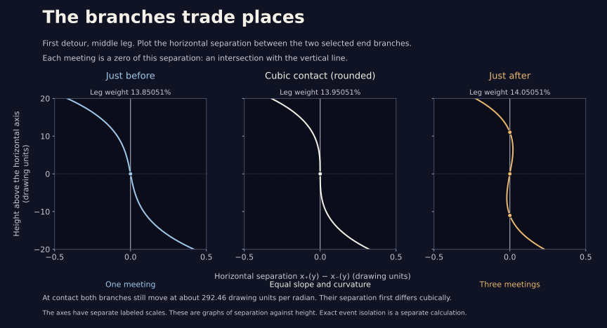

# Moving branches can meet

The next [visual study](phase.html) breaks reflection with a small phase.
Its [local calculation](phase_unfolding.md) proves the first contact's
two-thirds unfolding law and certifies six finite-phase tangencies.

The [arm-detour lens](arm_detour.html) follows a closed gold arc around
`t = π`. Its ends meet at the unique axis return `π±u`. The
[lens certificate](arm_detour.md#the-lens-has-a-continuous-subject) keeps
that choice continuous. It does not keep the arc simple.

Two kinds of selected meetings explain some changes in the picture:

* The two reflected end branches can have the **same vertical tangent**.
  Reflection forces a cubic contact here. A nearby pair of off-axis
  crossings appears or disappears.
* The ends can meet the **halfway visit** `t = π`, giving three specified
  visits to the same point, with pairwise transverse directions.

All these visits have nonzero velocities, as the full-family
[speed certificate](arm_detour.md) already proves. This is a census of
these two kinds of meeting for the **selected axis return**. Other
branches and other changes in the crossing graph are outside its scope.

## Where the meetings occur

Weights below are local to one of the three equal legs on the slider.
For example, 13.9505% on leg 2 is slider position `1.139505…`.

| Detour | Leg | Local weight, approximately | Meeting |
| --- | --- | ---: | --- |
| 2 / 3 → 4 / 7 | 2 · Change drawing | 0.139505126194 | Cubic contact; extra crossing pair after |
| 2 / 3 → 4 / 7 | 2 · Change drawing | 0.464144224361 | Three visits meet |
| 4 / 7 → 6 / 11 | 1 · Lengthen arm | 0.230341296003 | Three visits meet |
| 4 / 7 → 6 / 11 | 1 · Lengthen arm | 0.745346790609 | Cubic contact; extra crossing pair before |
| 4 / 7 → 6 / 11 | 2 · Change drawing | 0.246038825517 | Cubic contact; extra crossing pair after |
| 4 / 7 → 6 / 11 | 3 · Bring arm home | 0.332044921127 | Three visits meet |

There are exactly **three cubic contacts** and **three coincidences with
the halfway visit** of these kinds across all six complete legs. None
is at a leg join. A “three visits” row does not exclude an additional
visit from elsewhere on the full orbit.

## Two polynomials in addition to the axis return

Put `c = cos u`, `s = sin u > 0`. At each endpoint of a leg, let

```
X(c) = −R c + 140 Tₘ(c) − 65 Tₙ(c),
G(c) = −R + 140 Uₘ₋₁(c) + 65 Uₙ₋₁(c),
H(c) =  R − 140 m Uₘ₋₁(c) + 65 n Uₙ₋₁(c),
D(c) = [X(c) − X(1)] / (1−c).
```

Here `Tₖ(cos u) = cos(ku)` and `sin(u) Uₖ₋₁(cos u) = sin(ku)`.
The numerator defining D vanishes at 1, so D is a polynomial. The
shifted curve obeys

```
x(π+u) = X(c),       y(π+u) = s G(c),
x′(π+u) = s H(c).
```

Every polynomial depends affinely on the leg weight `a`. The selected
axis return satisfies `G(c,a) = 0`, with `G_c > 0` and

```
b = y′(π+u) = −s² G_c < 0.
```

The reflected velocities are `(+sH,b)` and `(−sH,b)`. They share a
vertical direction precisely when **H = 0**. The halfway visit shares
their point precisely when **D = 0**. At every accepted three-visit
event H is nonzero; the halfway velocity is vertical and upward, so all
three directions are pairwise transverse.

## Isolate every selected event exactly

Write `G = G₀ + a g` and `F = F₀ + a f`, with `F = H` or `F = D`.
Eliminating the weight leaves

```
P(c) = G₀(c) f(c) − F₀(c) g(c) = 0.
```

The program takes P’s square-free part, removes roots at the excluded
cosine boundaries 0 and 1, and isolates **all** its roots in `(0,1)` by
exact Sturm arithmetic. Exact dyadic roots, including an extraneous
candidate at `c = 1/2`, are divided out and retained as exact root boxes.
For every candidate, interval arithmetic proves `g != 0` and encloses
`a = −G₀/g`. A candidate is either strictly outside `[0,1]` or strictly
inside. An unresolved denominator, weight, or sign stops the proof.

The resultant identity then gives both G = 0 and F = 0 at every accepted
algebraic cosine. The unique-axis-return certificate places it on the
arc followed by the lens. At each event the program also proves

```
J = G_c F_a − F_c G_a != 0.
```

For F = D, this says that the end point passes the halfway point as the
weight changes: `dD/da = J/G_c` along the selected return.

## Why the tangent contact is cubic

Near either end visit, `b != 0` makes x an analytic function of height y.
Reflection gives two branches `x₊(y,a)` and `x₋(y,a) = x₊(−y,a)`.
Their separation is odd in height. At a contact weight `a₀`,

```
x₊(y,a) − x₋(y,a) = 2 A(a) y + 2 C y³ + higher terms,
A(a₀) = 0,     A = x′/y′ = s H / b.
```

Both branches have the same quadratic term, so their first different
term is cubic when C is nonzero. In terms of ordinary orbit derivatives,

```
C = [x‴ b − 3 x″ y″] / (6 b⁴).
```

At G = H = 0 this becomes

```
C = s³ B / (6 b⁴),
B = −6 c H_c G_c + (1−c²)(3 H_c G_cc − H_cc G_c).
```

The exact interval checks give **B < 0 at all three contacts**, hence
C < 0. Along the axis return, `sign A′(a₀) = −sign J`, so A′ is nonzero.
Divide the odd separation by y and put `r = y²`. The implicit function
theorem gives one nearby solution `r(a)` with

```
r(a) = −A′(a₀)/C · (a−a₀) + O((a−a₀)²).
```

On the side where r is positive, its two square roots give exactly two
additional nearby off-axis crossings. Their height grows like the
square root of the weight displacement. J is negative, positive,
negative at the three contacts in table order; together with C < 0 this
gives the “after, before, after” sides in the table.

These are cubic contacts constrained by reflection. The equal
curvatures explain why an ordinary quadratic tangency would be the wrong
local picture. Each moving branch itself stays smooth and regular.



The graph compares weights 0.001 below and above the first contact. It
plots the difference between the two branch positions, using height as
their local coordinate. A zero of that difference is a meeting of the
branches. Its axes have separate scales; they measure separation and
height rather than displaying the full orbital drawing.

Run:

```sh
python3 experiments/arm_detour_events.py
python3 experiments/arm_detour_events.py --numeric
```

The standard-library calculation checks G, H, and D against 336 exact
position/velocity comparisons, checks polynomial division and
square-free reduction, and exercises a root polynomial with both
rational and irrational roots. It reruns the six continuous lens covers
before reporting the selected events.

The optional numerical check reconstructs the two branches independently
with complex Fourier derivatives and height inversion. At all three
contacts their measured cubic separation agrees with the Taylor formula.
It then locates the extra crossings at weight displacements 10⁻⁴, 10⁻⁵,
and 10⁻⁶ on the certified side. The observed heights agree with the
square-root estimate within 0.1% and approach its coefficient as the
displacement shrinks. These comparisons do not decide any proof sign.

`python3 experiments/plot_arm_contact.py` regenerates the optional graph
using Matplotlib. That plotting dependency stays outside the website and
the standard-library certificates.
