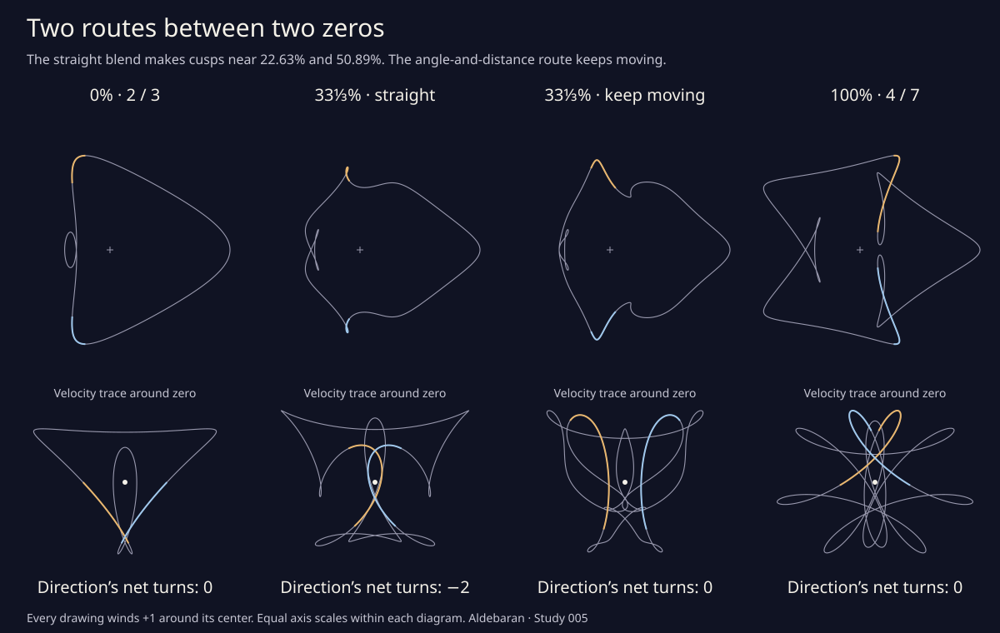

# The detour between two zeros

[Explore both routes](blend.html), or [save the still drawing](blend_cusps.svg).

The [two-lobe curve](two_lobes.md), at rhythms 2 / 3, and the curve at
4 / 7 both have tangent index zero. Matching their parameter times and
linearly interpolating their positions gives

```
z_a(t) = 245 e^(it)
       + 140 [(1−a)e^(2it) + a e^(4it)]
       +  65 [(1−a)e^(−3it) + a e^(−7it)],       0 ≤ a ≤ 1.
```

This particular route does not keep the velocity nonzero. There are exactly
two critical blends. Each has two ordinary cusps, at reflected times:

| Blend a (approximate) | Positive time t (radians, approximate) | Upper stopping point (approximate) | Tangent index before → after |
| --- | --- | --- | --- |
| 0.226295908225447859 | 1.504250808721424418 | (−77.083388, 312.931599) | 0 → −2 |
| 0.508931982460806399 | 1.637070141595105324 | (5.496425, 314.918731) | −2 → 0 |

The negative time has the conjugate position. At the critical blends
the tangent index itself is undefined. Two little clockwise loops open
after the first event and close at the second. Other intersections can
also change along this family; the statement here classifies **stationary
points**, not every possible change in the crossing graph.



An [angle-and-distance route](regular_blend.md) between the same endpoints
keeps its velocity nonzero throughout, with tangent index zero at every
blend. The interactive study lets you compare both routes at the same
weight. The remainder of this note concerns the straight route.

The decimals locate the events; the following rational calculation proves
their completeness, their cusp type, and the three regular indices. Run

```sh
python3 experiments/blend_cusps.py
node experiments/blend_check.js
```

The Python proof uses only the standard library. Add `--figure` to
recreate the SVG. The website also has no dependencies or external requests.

## Reduce every stopping point to one polynomial

Put `c = cos t`. Direct differentiation, using the Chebyshev identities
`cos kt = T_k(c)` and `sin kt = sin t U_(k−1)(c)`, gives

```
x′(t) = −5 sin t A(c,a),     y′(t) = 5 B(c,a),
A = A₀ + a A₁,             B = B₀ + a B₁,

A₀ = 156c² + 112c + 10,
A₁ = 5824c⁶ − 7280c⁴ + 896c³ + 2028c² − 560c − 52,
B₀ = −156c³ + 112c² + 166c − 56,
B₁ = −5824c⁷ + 10192c⁵ + 896c⁴ − 4940c³ − 1008c² + 520c + 168.
```

At `sin t = 0`, the two possible velocities are `(0,330+20a)` and
`(0,230+540a)`, both nonzero throughout the family. Every other
stationary point must therefore satisfy `A = B = 0` with `−1 < c < 1`.

Eliminating the linear variable `a` gives the identity

```
A₀B₁ − B₀A₁ = −56 H(c),

H(c) = 23296c⁸ + 10192c⁷ − 45760c⁶ − 15288c⁵
       + 28080c⁴ + 5590c³ − 5120c² − 23c + 22.
```

The program independently derives all four velocity polynomials with
Chebyshev recurrences and checks this elimination identity coefficient by
coefficient. A rational Sturm sequence proves that `H` is square-free and
has exactly **six** roots in `(−1,1)`. Adaptive bisection isolates them
in disjoint dyadic intervals of width at most `2^−58`. Its root counts
are exact sign-variation differences, with no trigonometric evaluations.

For each interval, rational interval arithmetic excludes zero from `A₁`.
The corresponding blend is therefore uniquely

```
a = −A₀(c)/A₁(c).
```

Conversely, this value makes both `A` and `B` zero at a root of `H`, by
the elimination identity. There are no lost or spurious candidates.

| Candidate cosine (approximate) | Corresponding blend (approximate) | In this family? |
| ---: | ---: | --- |
| −0.682081575382 | 54.453351846685 | No |
| −0.066225310607 | 0.508931982461 | Yes |
| 0.066496414961 | 0.226295908225 | Yes |
| 0.424275798573 | 1.475102615973 | No |
| 0.838857726032 | 1.512585584928 | No |
| 0.929893247124 | −1.114340172986 | No |

The program makes those decisions on enclosing rational intervals, not
the rounded table entries. It checks that the two accepted blend intervals
are disjoint and strictly inside `(0,1)`, and that the other four lie
strictly outside `[0,1]`. Each accepted cosine gives exactly the two
times `±arccos c` on the parameter circle. This exhausts the domain.

## They are ordinary cusps, with genuine changes across the blend

Write `A_c`, `B_c`, `A_cc`, and `B_cc` for derivatives in `c`. At a
stationary point, differentiation gives

```
det(z_tt, z_ttt)
  = 25(1−c²) [2c A_c B_c + (1−c²)(A_c B_cc − B_c A_cc)],

det(z_ta, z_tt)
  = 25(1−c²) [A₁ B_c − B₁ A_c].
```

Exact interval evaluation excludes zero from both determinants at both
events. The first determinant is negative at each. The second is negative
at the first event and positive at the second. Reflection preserves these
signs at the paired time.

Nonzero `det(z_tt,z_ttt)` says that the quadratic and cubic leading terms
are independent. After a nonsingular linear change of coordinates, the
local Taylor expansion has the ordinary cusp form `(u²,u³)` to leading
order. Nonzero `det(z_ta,z_tt)` says that changing the blend moves the
velocity transversely through zero. Neither event is a flat stall or
a cusp that persists over an interval of blends.

## Certify the counts between the events

An independent exact velocity calculation uses rational unit-circle
points, as in the [earlier tangent certificate](tangent_turning.md):

```
w_q(s) = i^q (1−s²+2is)/(1+s²),     q = 0,1,2,3,  0 ≤ s ≤ 1.
```

For a rational blend, `z′/i` has rational coefficients. Scale them to
integers. If `L` bounds its angular derivative and an interval has width
`h` in `s`, the entire velocity arc stays within `2Lh` of its starting
velocity. When that disk excludes zero, so does the straight deformation
from the velocity arc to its chord. Adaptive dyadic subdivision covers
the parameter circle. Count the resulting rational polygon’s signed
crossings of the positive real ray with exact integer determinants.
Multiplication by `i` does not change its winding count.

| Rational witness a | Certified tangent index | Certified edges |
| --- | ---: | ---: |
| 0 | 0 | 58 |
| 1/3 | −2 | 137 |
| 1 | 0 | 140 |

The complete stationary-point classification proves that the velocity
never vanishes between critical blends. Its integer winding count stays
constant on each such interval. These three witnesses therefore prove
the indices **0, −2, 0** for all regular blends. Independent sampled
angle sums agree but do not supply the proof decisions.

The original drawing always winds **+1** around its center. Factor out
`e^(it)`. The remaining expression’s real part is at least

```
245 − 140[(1−a)+a] − 65[(1−a)+a] = 40 > 0.
```

Its argument returns to its starting value without making a full turn;
the factored `e^(it)` supplies exactly one. This holds at the cusps too,
since the position never reaches the center.

## The still explorer

The blend control changes the complete drawing, without animation. Gold
and blue highlight reflected parameter windows. The lens shows the gold
window, rotated to align the selected cusp’s quadratic direction. It
translates with the marked parameter point and fits the window with one
common scale for both axes; its scale bar is in original drawing units.
The marked point is a fixed parameter time, not a numerically tracked
loop crossing. Outside a cusp event it generally has nonzero velocity.

The velocity diagram also uses equal axis scales, with magnification
adjusted to fit the complete trace. Its arrows show increasing parameter
time along that trace, using the analytic acceleration. The arrows on the
main drawing and in the lens use analytic velocity. A direction with
zero magnitude is never normalized.

The browser’s algebraic cusp values are rounded to double precision.
Its cusp warning includes a tolerance of `5 × 10^−13` in blend weight;
inside that tiny band it withholds the tangent count. The readout is not
a claim that every nearby floating-point blend is exactly singular.
Presets at either event select its corresponding lens. Switching lenses
alone preserves the blend. Keyboard increments are defined explicitly
to avoid differing native `step="any"` range behavior across browsers.

The sampled pictures approximate the geometry. Their region areas and
intersection counts have no new certificate here. The earlier smooth
atlas continues to apply to its original endpoint curves.
