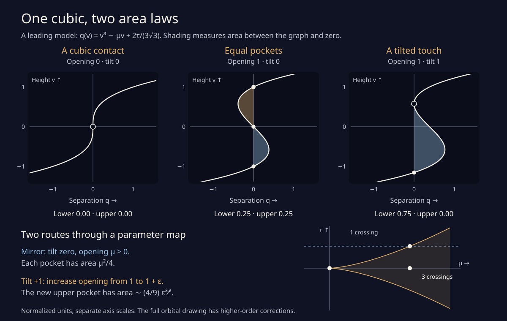

# One cubic, two area laws

The [phase study](phase.html) ends with two area laws. At the mirror
contact, each of two pockets grows like the square of the weight change.
After fixing a nonzero phase, the new pocket at a quadratic touch grows
with a three-halves power. These are different routes through one local
picture.

The [interactive model](cubic.html) draws that picture. It follows a
rescaled **leading cubic**, rather than the full orbital branches.
Everything about the cubic below has a short algebraic derivation.
Returning to the actual drawing requires a limiting argument; its finite
parameter boundary need not coincide with the model's.

## Start with the leading separation

Use the two height graphs from the [phase-unfolding note](phase_unfolding.md).
Their horizontal separation, later visit minus earlier visit, is

```
g(y, a₀+δ, φ) = 2 A δ y + 2 C y³ + B φ + higher terms,
A = A′ from the earlier note > 0,     C < 0,     B < 0.
```

The existing rational coefficient enclosures imply these strict signs.
Reflection gives `g(−y,a,−φ) = −g(y,a,φ)`. Assigning weights 1, 2, 3 to
y, δ, φ, respectively, leaves no omitted term of degree below five.
The branch charts are analytic near the contact, so the remainder and
its derivatives can be handled by their convergent local power series.

Put

```
L = sqrt(−A/C),       H = 2 A L,       P = −H/B > 0,
y = L h v,           δ = h² μ,        φ = P h³ ν,
ν = 2τ/(3√3),        h > 0.
```

Then, on every fixed compact set of v, μ, τ as h tends to zero,

```
−g(Lhv, a₀+h²μ, Ph³ν) / (Hh³)
    = q(v; μ,τ) + O(h²),
q(v; μ,τ) = v³ − μv + 2τ/(3√3).
```

The same convergence holds for any fixed finite number of derivatives
on a sufficiently small compact neighborhood. The minus sign reverses
which branch is to the right, while preserving roots and unsigned areas.
Numerically,

```
L ≈ 351.202920561,
P ≈ 18.229956983,
H L = −2 A²/C ≈ 588118.784382.
```

The area unit is `H L h⁴`: height supplies one factor h and horizontal
separation supplies three. Thus a model pocket of area F predicts
actual area `H L h⁴ [F + O(h²)]` when its bounding roots are simple
and the normalized parameters stay away from the discriminant.
The implicit function theorem gives the nearby roots. Moving the
integration endpoints causes no leading correction because q vanishes
there.

This is an area between the two selected graphs. Another branch of the
complete orbit may enter that space. No full-graph face claim follows.

## A cusp in the map, rather than a stopped tracing point

For μ ≤ 0, q is increasing, apart from a possible isolated zero derivative,
and has one distinct real root. For μ > 0 its extrema occur at
`v = ±sqrt(μ/3)`. Their values have opposite signs precisely when

```
μ³ > τ².
```

There are then three distinct real roots. At equality with μ positive,
there is one simple root and one double root. At μ = τ = 0 the root
is triple. Elsewhere there is one simple root.

Parametrize the double-root boundary by s:

```
q(v) = (v−s)²(v+2s),
μ = 3s²,     ν = 2s³,     τ = 3√3 s³.
```

Equivalently, in the page's parameter diagram it is
`(μ,τ) = (r²,r³)`. This is the semicubical cusp shown in gold.
It is a curve in **parameter space**. It does not assert a cusp of the
orbital drawing or a stationary tracing point. The original two branches
still have nonzero velocities at their meeting.

Inside the cusp the graph and its zero line bound two pockets. Outside
they bound none. On an ordinary boundary point one pocket has collapsed;
the other survives. At the tip both have collapsed together.

## Area directly from the roots

Let a and b be consecutive roots, with a ≤ b, and let c be the third.
Set `d = b−a` and `m = (a+b)/2`. In the coordinate `w = v−m`,

```
q(v) = (w²−d²/4)(w+m−c).
```

The odd part integrates to zero on `[−d/2,d/2]`, leaving

```
integral from a to b of q(v) dv = (c−m) d³/6,
pocket area = |c−m| d³/6.
```

The formula includes double roots by continuity. It also avoids
subtracting almost equal antiderivative values near a collapsed pocket.
The browser solves for the roots by bisection on monotone intervals,
then uses this factored formula. Its graph is a cubic Bézier segment;
no sampled polygon is needed to draw the model or its shaded pockets.
The semicubical boundary also has an exact cubic Bézier parametrization.
All displayed coordinates are still rounded floating-point numbers.

There is also a useful balance rule. Write the ordered roots as a, b, c
and their pocket areas as F_lower and F_upper. The signed polynomial
integrals give

```
F_lower + F_upper = μ²/2 + (3/2) μ b² − (9/4) b⁴,
F_lower − F_upper = b (c−a)³/4.
```

For fixed μ, differentiate with respect to `ν = 2τ/(3√3)`.
Endpoint terms vanish because q is zero at every endpoint:

```
dF_lower/dν = b−a > 0,
dF_upper/dν = −(c−b) < 0,
d(F_lower+F_upper)/dν = 3b.
```

The middle root b has the sign of ν and increases with ν, since
`ν = μb−b³` and `μ−3b² > 0`. Thus the sum is smallest at the mirror.
At fixed positive μ it increases from `μ²/2` there to `3μ²/4` at either
touch. One pocket gains more than the other loses. These unsigned local
areas do not contradict the phase-independent **global signed area**
of the complete orbital curve discussed in the earlier note.

## Through the tip: the square law

On the mirror route τ = 0, roots are `−sqrt(μ), 0, +sqrt(μ)` for μ > 0.
Each pocket has area

```
F_lower = F_upper = μ²/4.
```

Returning to the drawing with μ = 1 and `h = sqrt(δ)` gives

```
each area = (−A²/(2C)) δ² + O(δ³).
```

This recovers the earlier coefficient, approximately 147029.696095,
without a separate model. The area has the square law because the
height scale is sqrt(δ) and the separation scale is δ^(3/2).

## Across a smooth boundary: the three-halves law

Fix a positive ν. Its touch has

```
s = (ν/2)^(1/3) > 0,     μ_contact = 3s².
```

Increase opening to `μ = 3s²+ε`, and write `v = s+w`. Exactly,

```
q(s+w) = 3s w² + w³ − s ε − ε w.
```

The two new roots satisfy `w = ±sqrt(ε/3) + O(ε)`.
Rescale w by sqrt(ε) and integrate, or use the three-root area formula:

```
new pocket area = (4s/(3√3)) ε^(3/2) + o(ε^(3/2)).
```

For the page's tilted route τ = 1, `s = 1/√3` and μ_contact = 1,
so the coefficient is **4/9**. The surviving pocket at the touch has
area `27s⁴/4 = 3/4`. It is three times the area of either mirror pocket
at the same opening μ = 1. The negative-tilt route exchanges the pockets.

The quadratic orbital contact has its own finite-scale coefficients
`g_a` and `g_yy`. Its three-halves coefficient is the one already
[enclosed by rational boxes](phase_unfolding.md#the-little-pocket-has-a-different-area-law).
The number 4/9 belongs to the normalized cubic route; it is not that
finite-scale orbital coefficient.

## The common shape parameter

For any positive δ choose `h = sqrt(δ)` and μ = 1. Then

```
τ = φ / [(2P/(3√3)) δ^(3/2)].
```

Holding this ratio fixed keeps one limiting model shape. Its two pocket
areas, when `|τ| < 1`, are the two functions obtained from the roots of
`q(v;1,τ)`. Multiplying them by `H L δ²` gives the common leading
prediction for the original pockets. It includes the mirror value
`F_lower(0) = F_upper(0) = 1/4`.

The cubic boundary predicts `|φ| = (2P/(3√3)) δ^(3/2)`.
Inverting gives `δ ∼ 0.2728418 |φ|^(2/3)`, in agreement with the
previous local tangency theorem. For the actual family this is a
**leading** discriminant. The earlier reflection argument gives a
weight correction of order `|φ|^(4/3)`, rather than exact equality
with the model at finite phase.

The two limits therefore fit together without becoming interchangeable.
Setting φ to zero and approaching the tip gives the square law.
Fixing a nonzero φ and approaching its own shifted contact gives the
three-halves law. Close to a boundary, small higher-order corrections
can be large relative to the tiny new pocket. The common-limit numerical
comparison deliberately stays inside the three-root region.

## Checks and reproduction

```sh
node experiments/cubic_check.js
python3 experiments/cubic_pockets.py
python3 experiments/cubic_pockets.py --figure
```

Both use only their standard runtimes. The JavaScript checks all
**60,501 native slider combinations**, classifying them independently
with integer discriminants. Root residuals, Vieta identities,
reflection, independent exact-cubic Simpson integrals, Bézier evaluation,
tiny pockets, scaled cusp neighborhoods, and invalid inputs are checked.
There are **693,208 checks**; the largest root residual is below
1.3 × 10⁻¹⁵ normalized units. These numerical checks support the
implementation; the preceding algebra proves the model identities.

The Python program checks **2,095 exact rational examples** of the
identities. Its separate trigonometric root solver checks the fold law.
For ε from 0.01 to 0.000001, model area divided by `(4/9) ε^(3/2)`
approaches one, from 1.001665279 to 1.000000166.

It also imports the earlier rational orbital coefficient enclosures,
then compares actual orbital roots and numerical Simpson quadrature
with the common model. Across 20 comparisons the two area ratios
converge to one, with reflected tilts exchanging the columns:

| Normalized tilt τ | h | Lower area / prediction | Upper area / prediction |
| ---: | ---: | ---: | ---: |
| 0 | 0.04 | 0.981660804 | 0.981660804 |
| 0 | 0.005 | 0.999710151 | 0.999710151 |
| +0.5 | 0.04 | 0.984115876 | 0.974604090 |
| +0.5 | 0.005 | 0.999749232 | 0.999597624 |
| +0.9 | 0.04 | 0.985334536 | 0.919313863 |
| +0.9 | 0.005 | 0.999768588 | 0.998706479 |

The normalized sampled separation error drops by roughly four whenever
h halves, as the `O(h²)` remainder suggests. Quadrature is repeated at
two resolutions. These are numerical checks, **not interval area
enclosures**. No new continuous two-parameter orbital event census is
claimed. The earlier coefficient certificate is reused without changes
to the frozen intersection-certificate source or atlas.

The figure generator needs no plotting packages and writes a deterministic,
accessible [standalone SVG](cubic.svg). It also works when the interactive
scripts are unavailable.


