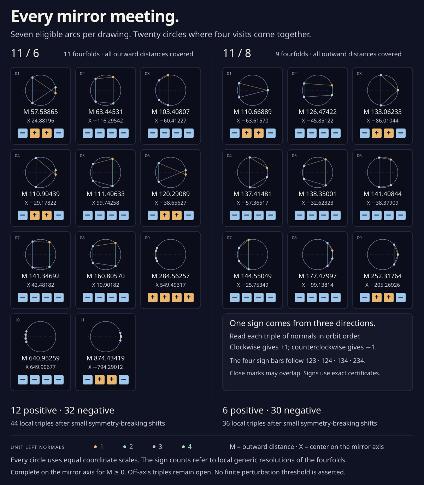

# Seven arcs, twenty mirror meetings

On the **complete outward offset leg**, rhythms **11 / 6 have exactly
eleven higher meetings on the mirror axis; 11 / 8 have exactly nine**.
Every one has exactly four visits and six transverse tangent pairs.
There is no ordinary axis triple and no axis meeting with six or more
visits, for any outward distance M≥0.

This is a complete **axis** census of the original mirror-symmetric
families. The off-axis triple census remains open. Ordinary two-visit
crossings and inverse touches are separate from the higher meetings
counted here.

The [standard-library verifier](offset_axis_census.py) discovers its roots
from a rational cover, with **no numerical hints and no saved roots**.
The [record](offset_axis_census.json) archives the freshly proved boxes.
It repeats the [fixed-visit exclusion](parallel_offset.md#two-fixed-visits-stay-alone)
before covering the rest of the axis.



[Open or save the full-size atlas](offset_axis_census.svg). All unit circles
use equal coordinate scales; gold marks positive signs and blue negative
ones, with explicit + and − symbols too. The connecting segments follow
orbit order 1,2,3,4,1. Some normals are close enough that their dots overlap
at this scale. The rational sign bars remain distinct.

## Every circle in the list

The following decimals are for reading. Proof decisions use rational
intervals. The sign columns count ordinary triple passages after a small
local resolution of each fourfold; the symmetric fourfold itself is
one event, not four distinct ordinary events.

| 11 / 6: M, approximately | Axis center X, approximately | Positive triples | Negative triples |
| ---: | ---: | ---: | ---: |
| 57.58864556 | 24.88196378 | 2 | 2 |
| 63.44530835 | −116.29541605 | 0 | 4 |
| 103.40806949 | −60.41227437 | 0 | 4 |
| 110.90439434 | −29.17821947 | 2 | 2 |
| 111.40633170 | 99.74258280 | 0 | 4 |
| 120.29088761 | −38.65626505 | 2 | 2 |
| 141.34692217 | 42.48181625 | 0 | 4 |
| 160.80570412 | 10.90182409 | 0 | 4 |
| 284.56257048 | 549.49316541 | 4 | 0 |
| 640.95259232 | 649.90677452 | 0 | 4 |
| 874.43418806 | −794.29012289 | 2 | 2 |
| **11 circles** | | **12** | **32** |

| 11 / 8: M, approximately | Axis center X, approximately | Positive triples | Negative triples |
| ---: | ---: | ---: | ---: |
| 110.66889031 | −63.61570249 | 2 | 2 |
| 126.47422424 | −45.85122066 | 0 | 4 |
| 133.06233295 | −86.01043961 | 2 | 2 |
| 137.41480855 | −57.36517178 | 0 | 4 |
| 138.35000996 | −32.62322637 | 0 | 4 |
| 141.40844171 | −38.37909299 | 0 | 4 |
| 144.55049269 | −25.75348806 | 0 | 4 |
| 177.47997204 | −99.13813942 | 0 | 4 |
| 252.31763521 | −205.26926328 | 2 | 2 |
| **9 circles** | | **6** | **30** |

In particular, there is **no higher axis meeting for M≥875 on 11 / 6
or M≥253 on 11 / 8**. This small axis bound does not replace the much
larger existing global tail bound, which also excludes off-axis triples.

The [earlier selected-positive proof](offset_positive.md) already found
all the positive axis contributions: four mixed circles and one
all-positive circle on 11 / 6, three mixed circles on 11 / 8. The twelve
additional circles found by this cover are all-negative. Each endpoint
has six of them.

## An axis circle is a projective point

Write the original upper-half parameter as c=cos t, −1<c<1, with
s=sin t>0. The existing Chebyshev polynomials give

```
q = (x(c), sY(c)),       v = (−sV(c), w(c)),
L = −Y/V,
A = xV−Yw,
R = x²+(1−c²)Y²,
D = RV−2xA.
```

The circle tangent at this visit with center on the real axis has

```
X=A/V,       M=L|v|,       M²−X²=D/V.
```

Its offset is outward exactly when L>0. Two distinct eligible upper-half
visits give the same outward circle exactly when the two coordinates
X and M²−X² agree. Their reflections supply two more visits.

Instead of dividing by V everywhere, retain the homogeneous point

```
P(c)=[A(c),D(c),V(c)].
```

The degrees of (A,D,V) are (16,27,10) for 11 / 6 and (18,29,10) for
11 / 8. Exact Euclidean division shows Y and V have no common root.
At a V pole, vₓ=0, so the speed bound makes w nonzero. Then A=−Yw≠0:
P is still a valid projective point. Its A chart gives the finite
ratios V/A and D/A there.

A pole itself is not an axis visit of a finite offset: its original
y=sY is nonzero while the normal's vertical component is zero. Keeping
these poles in the cover is a convenient way to include arbitrarily
large circles without a numerical upper bound on M.

## Seven arcs, with no self-return on one arc

Complete Sturm isolation finds four simple interior roots of Y and ten
of V at each endpoint. Their 40-bit dyadic brackets are strictly
disjoint. Sign evaluation between them gives exactly **seven components
with −Y/V>0**. The endpoints c=±1 have YV>0, so these components stay
away from the two fixed visits. Their finite Y boundaries, where M=0,
are included in the closed cover too.

The circle center is strictly monotone on each eligible component.
Differentiate X=x+Lvᵧ and L=y/vₓ with respect to t:

```
dX/dt = (|v|²+L det(v,v′))/vₓ.
```

Both endpoints have

```
|v|≥1540−765=775,
det(v,v′)≥1540·16940−1540·4405−765·16940−765·4405
          =2,974,975>0.
```

For L≥0 the numerator is strictly positive, and vₓ has fixed nonzero
sign on the component. Thus two distinct visits in the same component
cannot have the same X. **Only the 21 pairs of different components
need a product cover.** No divided-difference diagonal calculation is
needed.

Each actual component is covered by the rational interval from the
*lower* end of its left root bracket to the *upper* end of its right
bracket. This deliberately includes the tiny uncertain boundary pieces.
The cover never discards them by assuming an approximate root location.

## Exact Bernstein bounds and three affine charts

On a closed rational interval, express each polynomial in the same
degree-n Bernstein basis:

```
p(low+(high−low)u)=Σ bₖ binom(n,k) uᵏ(1−u)ⁿ⁻ᵏ,    0≤u≤1.
```

Clear denominators with one positive factor shared by A,D,V. Every
control row is then an integer tuple. De Casteljau bisection uses only
integer additions and powers of two; it also retains the exact common
factor. Differentiating the control row gives n(bₖ₊₁−bₖ)/(high−low),
so both value and derivative enclosures follow from convex hulls.

When a denominator control row is strictly positive or strictly
negative, a ratio of two polynomials lies between the smallest and
largest corresponding control ratios. This follows by writing it as a
convex combination with weights proportional to the denominator controls;
the weights stay positive for a negative denominator row too.

For each product rectangle, try all three denominator coordinates A,D,V.
If a shared affine chart has disjoint ratio ranges in either coordinate,
the two projective arcs cannot meet anywhere in that rectangle. This
also handles pairs approaching different poles.

That last chart check matters. The two equations

```
F₁=A(c)V(d)−A(d)V(c)=0,
F₂=D(c)V(d)−D(d)V(c)=0
```

vanish automatically at **any pair of V poles**, even when those poles
are different projective points. A two-equation resultant or contraction
alone does not distinguish them. The independent controls include
`P(t)=[1,t,t²−1]`: t=−1,+1 give a genuine nonsingular root of these two
equations, yet [1,−1,0] and [1,+1,0] are separated in the A chart.

## The full closed cover

If projective bounds do not exclude a product rectangle, bisect its
longer side. Below width 1/1000, also test the two-equation system F
with a rational preconditioner R from its midpoint Jacobian. For the
midpoint z and radius rectangle B, every zero satisfies

```
x−z ∈ −RF(z)+(Id−R DF(B))(B−z).
```

An image disjoint from the original rectangle excludes every zero.
A strictly interior image with infinity norm `|Id−R DF(B)|∞<1`
proves exactly one root by contraction. Both operations use exact
rational arithmetic. Unknown results require subdivision; reaching the
depth limit rejects the proof.

The final covers have:

| Endpoint | Initial rectangles | Bisections | Projective exclusions | Mean-value exclusions | Root leaves | Maximum added depth |
| --- | ---: | ---: | ---: | ---: | ---: | ---: |
| 11 / 6 | 21 | 1,426 | 1,346 | 90 | 11 | 18 |
| 11 / 8 | 21 | 2,188 | 979 | 1,221 | 9 | 19 |

In both rows, terminal leaves equal initial rectangles plus bisections.
Every bisection covers both closed children. Roots strictly inside their
unique leaves cannot be double-counted across boundaries.

Repeated mean-value intersections retain each proved root and narrow
its cosine boxes below 10⁻²⁸. Every new enclosure is rounded **outward**
to 128-bit dyadics and intersected with the preceding box. Each derivative
bound uses that current box and its own midpoint, so the complete
mean-value segment is always inside the domain being bounded.

On each refined box, strict rational tests prove V≠0, L>0, M>0,
and all six pairwise velocity determinants nonzero. Thus no accepted
two-equation root is a pole artifact or an inward circle. Reflection
supplies exactly the specified four visits.

Finally, all event-offset intervals within each family are **strictly
disjoint**. A circle with three upper-half visits would supply three
different arc-pair roots at the same M. That is impossible. Combined
with the fixed-visit proof, this excludes every fifth or higher branch
at the listed circles and every axis meeting with six or more visits
anywhere on the outward legs.

## The four signs, and what remains open

Order the visits as t₁<t₂<2π−t₂<2π−t₁. Their unit left normals give
each triple's normalized unfolding

```
H=−[det(Nᵢ,Nⱼ)+det(Nⱼ,Nₖ)+det(Nₖ,Nᵢ)].
```

Every H is strictly separated from zero. As in the
[selected fourfold calculation](offset_positive.md#a-fourfold-whose-four-signs-agree),
normal shifts (0,1,3,7) give the first-order equation

```
Nᵢ·Z+d=aᵢ.
```

Interval Cramer determinants certify four strictly separated first-order
d values at **every** circle in the census. Small supported perturbations
therefore resolve each into exactly four ordinary local triple passages.
The signs give **44 local triples, net −20**, on 11 / 6 and **36 local
triples, net −24**, on 11 / 8. The event neighborhoods are disjoint, so
these local resolutions can be chosen together. No finite numerical
perturbation-size threshold is asserted.

The original axis census contains no ordinary triples. The local counts
above concern the perturbed families. Triple passages away from these
resolved neighborhoods are still a separate global question.

The existing net outward changes −102 and −112 consequently leave net
changes **−82 and −88** for those other passages. The selected off-axis
positive pairs already supply at least 6 and 4 positives, forcing at
least 88 and 92 negatives there. Adding the resolved axis neighborhoods
recovers the existing bounds **138 and 132 outward triples**, and **992**
for the sufficiently distant complete construction. It does not improve
those bounds or prove that they are exact.

## Reproduce

Only standard Python and Node runtimes are needed:

```sh
python3 experiments/offset_axis_census_check.py
python3 experiments/offset_axis_census.py
python3 experiments/offset_axis_census.py --inner 8
python3 experiments/offset_axis_census.py --write
node experiments/offset_axis_census_check.js
node experiments/offset_axis_census_figure.js
```

The fresh full proof, including both fixed-visit exclusions, takes about
36 seconds in this session's container. The algebraic controls independently
audit power/Bernstein values, degree elevation, bisection, derivatives,
an exact genuine node, false pole roots, refinement, projective rescaling,
outward rounding, invalid inputs, and failed incomplete depth-limited covers.
Saved intervals and illustration coordinates never decide completeness.
Another **2,792 numerical checks** independently reconstruct the Fourier
circles, normals, all eighty signs and first-order weights, and actual
curved local resolutions at three small scales per fourfold. Their largest
meeting-position error is below 1.55×10⁻¹¹ drawing units; their largest
relative first-order position/offset prediction error is below 5.33×10⁻⁶.
These are implementation controls, separate from the exact certificates.
