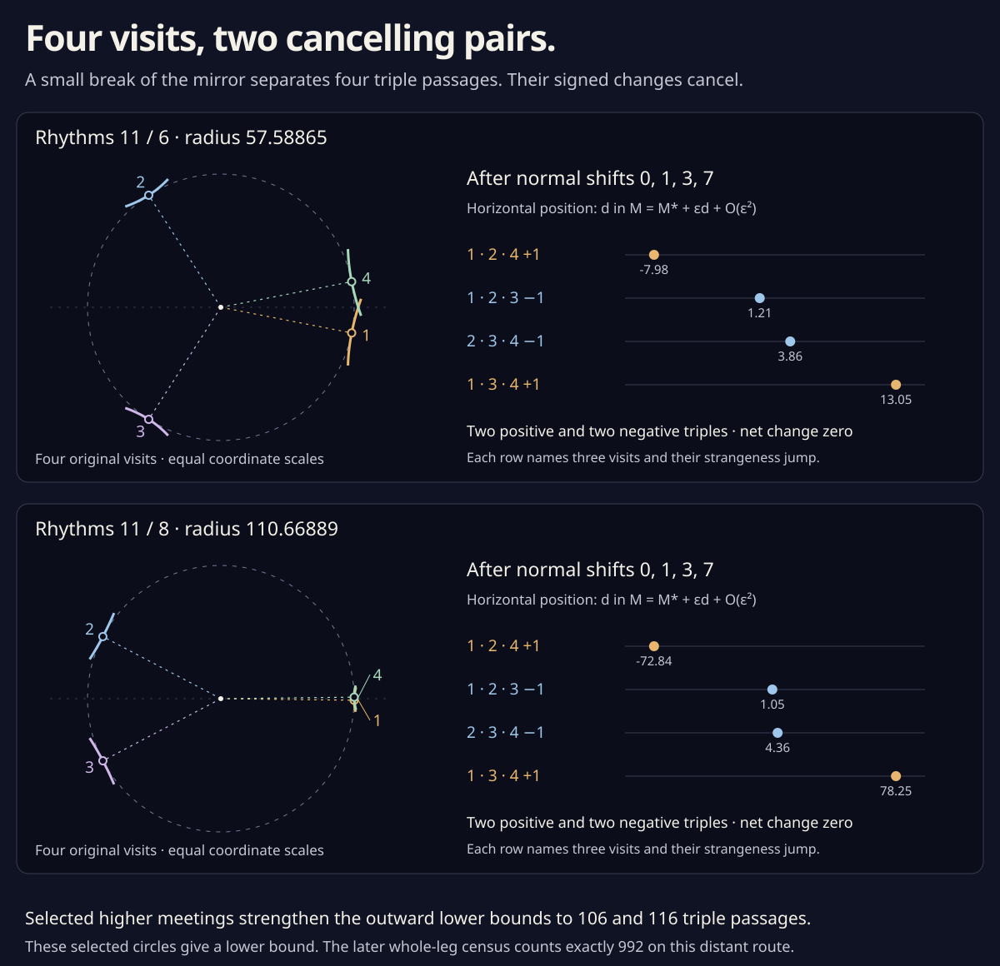

# Four visits, two cancelling pairs

The unperturbed outward-offset families contain selected **fourfold
meetings on their mirror axes**. A single circle touches four original
visits; moving outward by its radius brings all four to its center.
There is no fifth branch there, and all six tangent pairs are transverse.

One such meeting is now certified on each endpoint:

| Drawing | Outward distance, approximately | Meeting point, approximately |
| --- | ---: | --- |
| 11 / 6 | 57.58864556 | (24.88196378, 0) |
| 11 / 8 | 110.66889031 | (−63.61570249, 0) |

Each admits a small generic resolution into **four ordinary triple
passages: two positive and two negative**. Their strangeness changes
cancel. Consequently the earlier signed-change bounds can be strengthened:
nearby generic versions of these outward legs need at least **106 and
116 triples**, and the sufficiently distant complete constructed route
needs at least **944**, in addition to its 66 inverse touches.

These are **two selected higher meetings**, with local resolution proofs.
Their existence does not classify the other events or give exact total
triple counts on either outward leg.



The circles use equal scales within each panel. The right-hand rows use
a different coordinate: a first-order change in offset weight. Their
positions and printed decimals illustrate the separate
[rational record](offset_fourfold.json).

## Two rational equations find four visits

Write an original point as q=(x,y), its velocity as v=(vₓ,vᵧ), and its
acceleration as a. Suppose vₓ≠0. If an outward offset reaches the real
axis, its distance M and axis coordinate X must satisfy

```
L = y/vₓ,
M = L |v|,
X = x+L vᵧ.
```

Require L>0 to select outward motion. Define the rational quantity
`B=L²(v·v)=M²`. Two visits t,u then give the same positive-radius
axis circle exactly when

```
X(t)−X(u) = 0,       B(t)−B(u) = 0.
```

Both visits lie in (0,π), one in each of its rational circle quarters.
The orbital reflection identity supplies the other two visits
`2π−u, 2π−t`. The four parameters lie in four distinct quarters.
For the unit left normal N, `q−MN=(X,0)` at each visit, so these
are four equal offset points, not merely four points on a common circle.

The Jacobian is rational too. In the original time coordinate,

```
L′ = (vᵧ vₓ−y aₓ)/vₓ²,
X′ = vₓ+L′vᵧ+L aᵧ,
B′ = 2LL′(v·v)+2L²(v·a).
```

Multiply each column by its circle-chart factor `2/(1+s²)`. A square
of chart radius **10⁻¹²** passes an exact rational contraction for each
endpoint, with norm below **10⁻⁵** and strictly interior image. Rounded
Newton suggestions merely choose the centers. Four rational central-
difference comparisons per endpoint audit the Jacobian implementation.

The contraction image gives a narrower enclosure of each root. Round
it **outward** to 80-bit dyadics before further interval evaluation.
Keeping the very large intermediate exact fractions here would make
the same proof unnecessarily slow. Reflection maps an interval s to
`(1−s)/(1+s)` and quarter k to `3−k`, so it supplies exact enclosures
for the other two parameters.

The [offset arc cover](parallel_offset.md#a-third-branch-is-excluded-at-every-contact)
works with four admitted slots as well. It gives **627 arc exclusions
for 11 / 6** and **744 for 11 / 8**, covering the whole orbit outside
four x-monotone slots for the entire certified offset and point box.
No fifth visit can enter. The six velocity-pair determinants are
strictly separated from zero. Thus these really are four transverse
branches at a single point.

## Break the mirror by a specified amount

Label the visits 1,2,3,4 in orbit order. Near each visit, use its left
normal angle as local parameter and add a small constant to its support
distance:

```
hᵢ → hᵢ + ε aᵢ,       (a₁,a₂,a₃,a₄)=(0,1,3,7).
```

Smooth bumps make each shift constant near its visit and zero outside
four disjoint parameter neighborhoods. A further smooth offset-parameter
bump can confine the change near the fourfold event, fixing the original
and far-out endpoints. Sufficiently small ε preserves regularity,
positive curvature, the embedded conormal lift, and the existing
nondegenerate inverse contacts.

Let P be the old meeting point, δ=M−M*, and Nᵢ its four normals. To
first order the shifted branches have equations

```
Nᵢ·(q−P) = −δ+εaᵢ.
```

For each choice of three visits, set `q−P=εZ` and `δ=εd`. Solve
the three-by-three linear system

```
Nᵢ·Z+d=aᵢ.
```

Interval Cramer determinants enclose d; every denominator is separated
from zero. The four weight intervals are **pairwise disjoint**, with
the same order at both selected meetings:

| Triple visits | St change | d for 11 / 6, approximately | d for 11 / 8, approximately |
| --- | ---: | ---: | ---: |
| 1,2,4 | +1 | −7.97964044 | −72.84127899 |
| 1,2,3 | −1 | 1.20815039 | 1.04948860 |
| 2,3,4 | −1 | 3.85775626 | 4.35884732 |
| 1,3,4 | +1 | 13.04554709 | 78.24961490 |

The printed decimals are illustrations; strict rational interval
comparisons prove the order. For any ordered triple of unit normals,
its normalized unfolding expression is

```
H = −[det(Nᵢ,Nⱼ)+det(Nⱼ,Nₖ)+det(Nₖ,Nᵢ)].
```

Each H has a nonzero interval sign, giving the St jumps in the table
by the [three-line passage formula](triple_area.md). Positive branch
speed factors do not change those signs. Equivalently the four-variable
equal-point equations for each three-branch subset have a nonsingular
Jacobian in its three times and M. The implicit function theorem
therefore gives one ordinary triple near each subset under every
sufficiently small generic perturbation.

For the specified shifts their event weights are

```
Mᵢⱼₖ(ε) = M* + εdᵢⱼₖ + O(ε²).
```

The disjoint first-order d intervals separate all four events for
sufficiently small positive ε. The fourth branch stays away at each
resulting triple. Compact local separation and the fifth-branch cover
exclude any additional branch. This supplies a concrete local generic
resolution. No numerical upper bound on ε is asserted.

The numerical implementation also solves the actual curved, locally
shifted branches at ε=0.001, 0.0003, 0.0001, and 0.00003. Their scaled
event offsets approach these d values and retain their certified order
and signs. Those finite-ε checks supplement the analytic argument.

## Count what cancels

The [radial words](radial_word.md) give net outward triple changes −102
and −112. On either selected fourfold neighborhood, a small generic
perturbation has at least two positive triples as well as two negative
ones. In a complete generic outward leg let p and n count positive and
negative triples. Then

```
11 / 6:  n−p=102,  p≥2,  hence n+p≥106,
11 / 8:  n−p=112,  p≥2,  hence n+p≥116.
```

The middle has exactly 722 ordinary triples at a sufficiently large
common offset, 354 positive and 368 negative. Reverse the second
outward leg to return to 11 / 8. The full route therefore has at least
**470 positive and 474 negative triples**, or **944 in total**, with
net change −4. Its 33 inverse births and 33 inverse deaths persist.

This strengthens the **936** lower bound supplied by the radial signed
changes alone. It applies to sufficiently small generic versions of
the specified distant construction, rather than all routes between
the two drawings. Exact offset-leg triple counts and a numerical
common-offset threshold for the middle-event theorem remain open.

## Reproduce

Only standard Python and Node runtimes are needed:

```sh
python3 experiments/offset_fourfold.py
python3 experiments/offset_fourfold.py --write
node experiments/offset_fourfold_check.js
node experiments/offset_fourfold_figure.js
```

The Python calculation repeats both rational contractions, reflection
enclosures, whole-orbit fifth-branch exclusions, all six tangent-pair
tests per event, all four unfolding signs, the first-order perturbation
weights and their strict order, and eight exact Jacobian controls.
`--write` archives the freshly proved selected events. Numerical search
tallies are not used as a completeness argument or stored as certificates.
