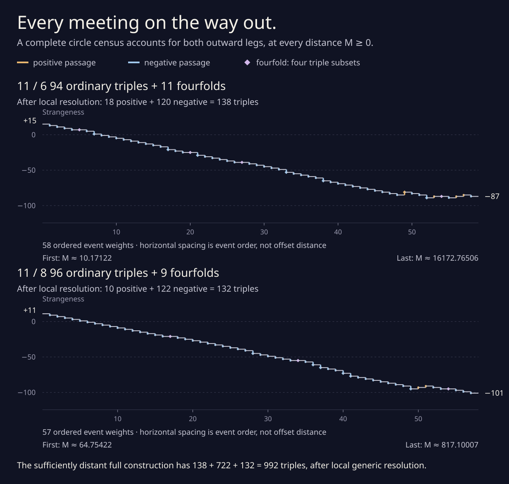
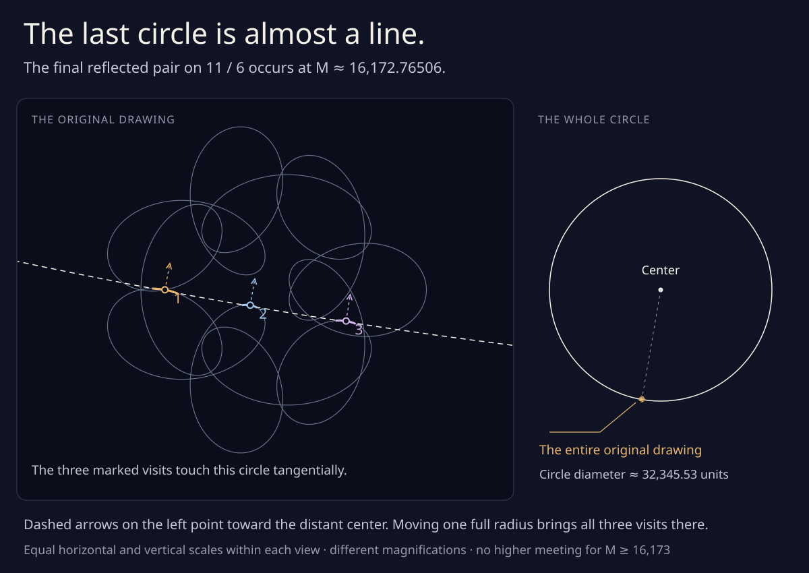

# Every meeting on the way out

The complete outward families now have a higher-meeting census, for
**every M≥0**, including the infinite end:

| Original drawing | Ordinary off-axis triples | Mirror-axis fourfolds | Positive triples after resolution | Negative triples after resolution | Total after resolution |
| --- | ---: | ---: | ---: | ---: | ---: |
| 11 / 6 | **94** | **11** | **18** | **120** | **138** |
| 11 / 8 | **96** | **9** | **10** | **122** | **132** |

Every listed triple has three transverse branches. Every fourfold has
four transverse branches and resolves into exactly four ordinary triples
under the previously certified small local normal shifts. There are
**no other triple or higher meetings**, and no off-axis fourfolds.
The unperturbed fourfold is one meeting; its four triple subsets count
as four ordinary passages only after that local generic resolution.

The [fresh verifier](offset_leg_census.py) uses exact integer and rational
arithmetic, with **no numerical suggestions or archived roots**. The
[record](offset_leg_census.json) stores the complete cover receipts,
all 270 isolated triple subsets, their signs, and their event grouping.
The website still needs no external packages.



[Open or save the full-size figure](offset_leg_census.svg). Horizontal
positions are the **order of event weights**, not equal increments of
outward distance. A diamond marks a fourfold; its net change can be zero
even though four ordinary passages appear after resolution. In the
standalone SVG, hover an event to read its distance and signs.
The [CSV event ledger](offset_leg_census.csv) lists every weight in
order, with exact rational radius bounds, an approximate decimal,
local sign counts, and strangeness before and after. It can be saved
or opened in a spreadsheet; a reflected pair is one row and two meetings.

The 11 / 6 family has **58 strictly separated event weights**: 47
reflected ordinary-triple pairs and eleven fourfolds. The 11 / 8 family
has **57 weights**: 48 reflected pairs and nine fourfolds. There are
105 higher-meeting points on each unperturbed leg, counting the two
points of a reflected pair separately and each fourfold once.

The last higher meetings are negative reflected triples near
**M=16,172.76506281** on 11 / 6 and **M=817.10006534** on 11 / 8.
Consequently there is **no triple or higher meeting for M≥16,173 or
M≥818**, respectively. These bounds follow from the complete circle
list and its rational radius enclosures. The earlier
[270,000 tail theorem](parallel_offset.md#a-smaller-tail-from-tangent-circle-equations)
remains a separate, coarser exclusion proof.



[The last circle is almost a line](offset_last_circle.svg) compares two
magnifications of the final 11 / 6 circle above the mirror axis. Both
views use equal horizontal and vertical scales. Dashed arrows point
toward its distant center. Regenerate this separate drawing with
`node experiments/offset_last_circle_figure.js`; its coordinates are
rounded illustrations of the rational circle record.

## Two visits trace two lines in circle space

Write the original curve and velocity as

```
q(t)=245 exp(it)+140 exp(11it)+65 exp(−int),   n=6 or 8,
v=q′,       N=Jv/|v|,       q_M=q−MN,
J(x,y)=(−y,x).
```

A circle with center P, radius M, and constant C=|P|²−M² has equation
`|q|²−2P·q+C=0`. All its outward tangencies at one visit q form the
following straight ray in coordinates (Pₓ,Pᵧ,C):

```
b(q)+L d(q,v),       L≥0,
b=(x,y,|q|²),
d=(vᵧ,−vₓ,2 det(q,v)),
P=q−LJv,            M=L|v|.
```

Thus any two visits of one offset meeting supply intersecting circle
lines. In particular, those lines must be coplanar. For visits (p,v)
and (q,w), put h=q−p and Δ=det(v,w). Expanding the lifted determinant
gives a much smaller division-free necessary equation:

```
det(d(p,v),d(q,w),b(q)−b(p))
       = |h|² Δ − 2(v·h) det(h,w) = 0.
```

When Δ≠0, the two normal-line parameters are

```
L_p=−(h·w)/Δ,       L_q=−(h·v)/Δ.
```

If an interval proves either parameter strictly negative, it excludes
every common outward circle in that pair product. The implementation
uses signs of numerators and denominator, without dividing. Parallel
tangents remain eligible unless the coplanarity polynomial excludes
them. These are necessary pair tests, **not circle-existence tests**.

## A complete pair graph

Four rational unit-circle charts cover the closed orbit:

```
exp(it)=i^quarter (1+is)²/(1+s²),       0≤s≤1.
```

Divide each chart into 512 closed intervals. For every unordered pair
of the resulting 2,048 arcs, either exclude it by a proved short-arc
argument, exclude it by the circle-line tests, or retain its edge.
The graph is built by visiting **every pair**; no spatial hash or sampled
root list decides which products enter it. Accounting checks that all
2,096,128 distinct-cell pairs have one recorded outcome.

The short-arc test applies uniformly to every outward M. The original
speed and curvature bounds are

```
|v|≥775,       |v′|≤21,345,       det(v,v′)≥2,974,975>0.
```

If the cyclic cell separation is d, the entire intervening arc has
length in t at most `2(d+1)/512`. Require
`2·21,345·(d+1)<3·775·512`. Its tangent turns strictly less than
3<π, so all its velocities lie in one fixed open half-plane. Since
`q_M′=(1+Mκ)v` is a positive multiple of v, projection in a suitable
fixed direction is strictly monotone. Two distinct offset visits cannot
coincide there. This also excludes two visits in one cell, adjoining
cells, and visits near the cyclic seam.

Every possible triple must therefore occupy three different cells
whose three edges were retained. **All graph triangles** supply a
complete initial cover of all possible three-visit meetings, for all
M≥0. This argument has no large-offset assumption and no upper bound
on the circle radius. It replaces the tail-only expanded-front filter
when covering the whole leg.

## Integer boxes, without floating-point predicates

At a rational chart midpoint, integer complex powers give exact
positions, velocities, and accelerations. The chart interval has a
t-radius no larger than its s-width r. Taylor bounds give

```
q ∈ q₀+v₀[−r,r]+[−Ar²/2,Ar²/2]²,
v ∈ v₀+a₀[−r,r]+[−Br²/2,Br²/2]²,
a ∈ a₀+[−Br,Br]²,
A=21,345,       B=245+140·11³+65·8³=219,865.
```

Each bound is rounded **outward** to 80-bit dyadics. For the many pair
and minor tests, it is rounded outward again to integer endpoints
representing 2⁵⁰ times the coordinate. Products retain their exact
integer scale. All comparisons, including signed rounding near zero,
use integers and fractions. Floating-point arithmetic enters only the
separate illustration and numerical controls.

## Pairwise compatibility is not concurrency

Three lines can be pairwise coplanar without sharing a point. Therefore
a graph triangle is only a candidate. For its three point/velocity
boxes, form the five homogeneous rows

```
(vᵢₓ,vᵢᵧ,qᵢ·vᵢ),                         i=0,1,2,
(2(qⱼ−q₀)ₓ,2(qⱼ−q₀)ᵧ,|qⱼ|²−|q₀|²),     j=1,2.
```

A finite tangent-circle center makes all rows annihilate (Pₓ,Pᵧ,−1).
Every 3×3 minor must vanish. Any strictly signed interval minor excludes
the whole product. All ten minors are available, with no division.
Parallel normals, repeated points, collinear points, and projective
limits are not discarded by an assumed nonzero denominator.

One control deliberately supplies three collinear original points with
parallel perpendicular velocities. Every pair passes the line filter,
but a chord minor excludes their nonexistent common finite circle.
Another supplies a limiting common tangent line, which the minors must
leave unresolved. Vanishing necessary conditions never count as an
existence proof.

## Closing every product

If neither the pair tests nor the minors exclude a product, bisect its
longest parameter interval. At small products, also solve the three
equations of tangency to their circumcircle. The two chord equations
give the circumcenter P; the residual is

```
Fᵢ=(qᵢ−P)·vᵢ,       i=0,1,2.
```

Differentiate the chord equations to bound every derivative of P,
then the full chart Jacobian DF. A zero-containing circumcenter
denominator returns **unknown** and requires further subdivision. It
does not exclude a box.

For the product midpoint z, an arbitrary rational preconditioner R,
and radius box B−z, every possible zero satisfies

```
x−z ∈ −RF(z)+(Id−R DF(B))(B−z).
```

An image disjoint from B excludes every zero. A strictly interior image
with infinity norm `|Id−R DF(B)|∞<1` proves one unique zero by contraction.
Unknown products must split, and an unresolved depth-limited product
**rejects the entire proof**. Every split covers both closed children.
The terminal-leaf total must equal initial products plus bisections.

All final leaves are exclusions or unique finite-circle roots. This
closes the unbounded-radius end too: a problematic limiting circle or
line would have left an unresolved parameter product and failed the
proof. No numerical cutoff for M was used to obtain completeness.

The canonical covers have the following receipts:

| Endpoint | Retained pair edges | Initial triple products | Bisections | Pair exclusions | Normal minors | Chord minors | Mixed minors | Mean-value exclusions | Root leaves | Maximum added depth |
| --- | ---: | ---: | ---: | ---: | ---: | ---: | ---: | ---: | ---: | ---: |
| 11 / 6 | 31,716 | 26,794 | 118,651 | 90,035 | 16,749 | 13,676 | 12,368 | 12,479 | 138 | 39 |
| 11 / 8 | 32,673 | 31,679 | 144,114 | 97,377 | 25,051 | 17,234 | 20,848 | 15,151 | 132 | 36 |

There are 145,445 and 175,793 terminal leaves, respectively. A shallower
trial of the first family really did leave two adjacent products
unresolved; the proof rejects such a partial result. The canonical
deeper cover closes both.

Repeated mean-value intersections retain each root and narrow all three
chart widths below 10⁻¹⁸, with a final defect norm below 10⁻⁵. Every
accepted outward root has strictly positive radius and direction,
three nonparallel tangent pairs, and a strictly signed normalized
unfolding

```
H=−[det(N₀,N₁)+det(N₁,N₂)+det(N₂,N₀)].
```

## Identifying events and excluding higher meetings

The verifier first repeats the independent [axis census](offset_axis_census.md)
and its fixed-visit proofs. Exact square-root bounds convert each axis
circle's cosine boxes into four ordered rational-chart boxes. Each of
its four triple subsets lies **strictly inside exactly one** new unique
root leaf. This establishes identity by uniqueness; rounded radii are
never used for matching. All eighty subset signs agree with the
independent axis calculation.

For every remaining root, exact chart reflection
`(quarter,s) ↦ (3−quarter,(1−s)/(1+s))`, in reverse visit order, lies
strictly inside its unique partner's root leaf. These are 47 reflected
pairs on 11 / 6 and 48 on 11 / 8. Their center y-coordinates are strictly
nonzero. Reflection preserves the passage sign.

Finally, every pair of distinct circles is separated by a strict radius
or center-coordinate interval, except the four already identified
subsets of one axis fourfold. Any additional branch would supply more
triple subsets at the same center and radius. The complete root list
and these separations rule it out. Thus every off-axis event has exactly
three visits, and every axis event exactly four.

## The constructed route has exactly 992 triples

The counts give the known net strangeness changes independently:

```
11 / 6:   18−120=−102,       15−102=−87,
11 / 8:   10−122=−112,       11−112=−101.
```

Choose disjoint small supported resolutions of the finitely many
fourfolds; their previously certified normal shifts give exactly four
ordinary triples each. Ordinary off-axis triples persist, and the
complete exclusion cover prevents additional triple events elsewhere
for sufficiently small perturbations supported in those neighborhoods.
The resolved outward counts are therefore **exactly 138 and 132**.

The [uniform radial-family argument](radial_word.md) supplies exactly
722 triples in the specified middle construction at sufficiently large
common offset. Combining its 354 positive and 368 negative passages
with the first outward leg and the **reversed** second leg gives

```
positive: 18+354+122 = 494,
negative: 120+368+10 = 498,
total:    138+722+132 = 992,       net=−4.
```

The route also has the previously counted **66 inverse touches and no
direct touches**. This is an exact count for this specified sufficiently
distant, locally resolved construction. It is **not a minimum over all
regular routes**. The middle family's numerical event-stability threshold
and a finite numerical size for the fourfold perturbations remain
unspecified.

## Reproduce

Only standard Python and Node runtimes are needed:

```sh
python3 experiments/offset_leg_census_check.py
python3 experiments/offset_leg_census.py
python3 experiments/offset_leg_census.py --inner 6
python3 experiments/offset_leg_census.py --write
node experiments/offset_leg_census_check.js
node experiments/offset_leg_census_figure.js
```

The exact controls independently audit the lifted determinant identity,
normal-line parameters and circle constants, integer interval arithmetic,
all vertex determinants of interval matrices, genuine circles, singular
obstructions, exact Fourier jets, Taylor arc bounds, every earlier selected
orbital fourfold, an independent circumcenter Jacobian, central differences,
reflection, invalid inputs, and incomplete covers that must reject.
The Node controls reconstruct the complete circles with independent
floating-point Fourier geometry; these numerical checks do not decide
the rational proof.
The exact controls also reprove all 270 roots with a different system:
four equal-offset-point equations in the three visits and M. Raw Fourier
intervals and unit normals replace the census's Taylor jets and
circumcenters. Normalizing the unequal coordinate radii gives a maximum
contraction norm below **0.000845** in the tested boxes. These are local
existence-and-uniqueness controls, using archived roots as proposals;
the complete parameter cover remains the source of global completeness.

For a faster exact **local** audit, run:

```sh
python3 experiments/verify_offset_leg_roots.py
```

This separate [root auditor](verify_offset_leg_roots.py) assumes the
archived pair-graph and whole-domain covers. It repeats both fixed-visit
and axis proofs, all 270 existence-and-uniqueness contractions, refinements,
outward directions, signs, reflections, and distinct-circle separations.
It compares every regenerated local field and event identification with
the record and cannot write a new complete certificate. Its successful
run took 40.02 seconds here. The full verifier above is required to
repeat **global completeness**. Corrupted signs, root enclosures,
contraction bounds, visit order, and missing roots must reject the audit.
