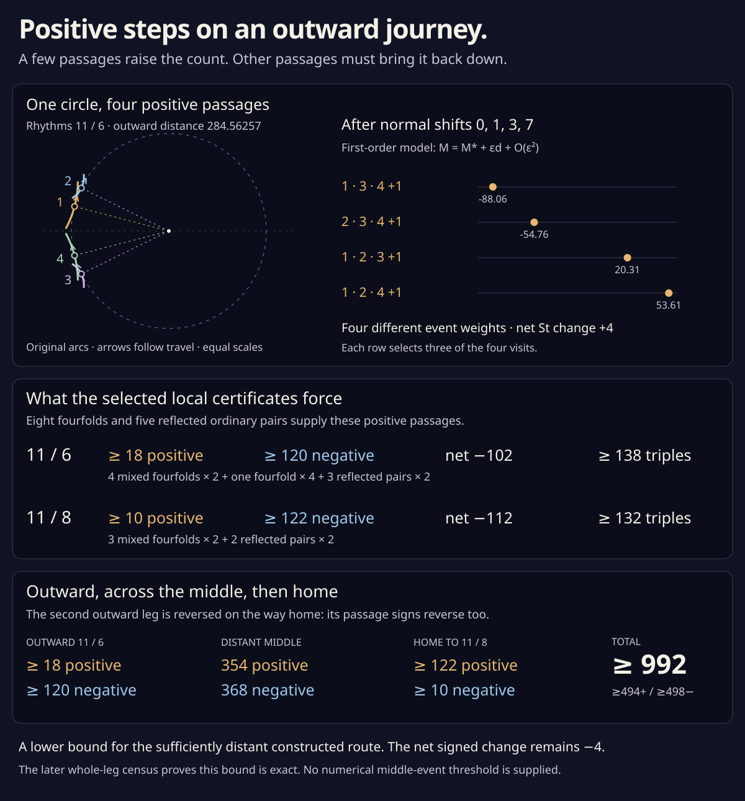

# Twenty-eight positive passages

The two outward legs have large **negative** net strangeness changes.
Nevertheless, selected events force **18 positive triple passages on
11 / 6 and 10 on 11 / 8**. Every positive passage requires another
negative passage to preserve the net change. The resulting lower bounds
are **138 and 132 outward triples**, and **992 triples on the sufficiently
distant complete construction**.

| Outward leg | Positive passages, at least | Negative passages, at least | Net St change | Total, at least |
| --- | ---: | ---: | ---: | ---: |
| 11 / 6 | 18 | 120 | −102 | 138 |
| 11 / 8 | 10 | 122 | −112 | 132 |

This is a lower bound for small generic versions of the
[specified offset construction](parallel_offset.md), not an exact event
count or a minimum over all routes. The numerical common-offset threshold
for its middle-event theorem remains unknown.

The later [complete leg census](offset_leg_census.md) proves that these
bounds are **equalities** for the specified locally resolved construction:
138 and 132 outward triples, and exactly 992 over the distant full route.
The selected-event argument below supplies the lower bound independently.



[Open or save the full-size diagram](offset_positive.svg). Its circle
uses equal coordinate scales. The first-order event weights on the right
illustrate rational enclosures; they do not assert a numerical allowed
perturbation size.

The [interactive study](four_visits.html) follows each of the four positive
triples in its straight local model. Choose three visits and move through
their meeting. A unit-normal circle explains the common sign. The
[standalone stills](four_visits.svg) show all four passages without scripts.

A subsequent [complete axis cover](offset_axis_census.md) proves that the
highlighted circle is the **only all-positive mirror-axis fourfold** on
the two complete outward families. There are eleven fourfolds on 11 / 6
and nine on 11 / 8; all positive axis contributions already appear among
the eight selected circles below. The twelve additional circles are
all-negative. The [twenty-circle atlas](offset_axis_census.svg) shows the
complete axis inventory. The later [whole-leg cover](offset_leg_census.md)
also classifies the off-axis events.

## Eight circles and five reflected pairs

Eight selected mirror-axis fourfold meetings have rational certificates.
Seven separate into two positive and two negative triples. The remaining
one separates into **four positive triples**.

| Drawing | Outward distance, approximately | Positive triples in the local resolution |
| --- | ---: | ---: |
| 11 / 6 | 57.58864556 | 2 |
| 11 / 6 | 110.90439434 | 2 |
| 11 / 6 | 120.29088761 | 2 |
| 11 / 6 | 284.56257048 | 4 |
| 11 / 6 | 874.43418806 | 2 |
| 11 / 8 | 110.66889031 | 2 |
| 11 / 8 | 133.06233295 | 2 |
| 11 / 8 | 252.31763521 | 2 |

Each is exactly four branches at its selected point: a whole-orbit cover
excludes a fifth, and all six tangent pairs are transverse. The first
circle on each drawing repeats the
[earlier cancelling-pair result](offset_fourfold.md).

Five selected **ordinary triple pairs** supply the other positive events.
Each pair consists of one meeting strictly above the mirror axis and its
exact reflection below. Each meeting has St jump +1, with no fourth branch.

| Drawing | Outward distance of a reflected pair, approximately | Positive triples |
| --- | ---: | ---: |
| 11 / 6 | 846.94856087 | 2 |
| 11 / 6 | 2397.49933729 | 2 |
| 11 / 6 | 12308.37565917 | 2 |
| 11 / 8 | 177.70279112 | 2 |
| 11 / 8 | 179.87243117 | 2 |

Thus the selected positive inventories are

```
11 / 6:  4·2 + 4 + 3·2 = 18,
11 / 8:  3·2     + 2·2 = 10.
```

The 450 bound for the absence of further **touches** does not bound triple
passages. These certified distant examples make that distinction concrete.
The full rational [record](offset_positive.json) stores visit boxes,
outward distances, points, unfolding signs, and isolation covers. Rounded
decimals in the tables are not proof predicates.

## A fourfold whose four signs agree

The [axis-circle equations](offset_fourfold.md#two-rational-equations-find-four-visits)
are unchanged. For a point q=(x,y) with velocity v, set

```
L = y/vₓ,     X = x+Lvᵧ,     B = L²(v·v).
```

Two distinct upper-half visits with the same X and B, and with L>0,
give four visits on one outward-offset circle by reflection. The new
verifier admits two disjoint boxes in the **same** quarter-circle chart.
It checks their exact order and separation, including the reflected
boxes; different chart numbers are not needed to distinguish visits.

At M≈284.56257048 the two upper-half times are approximately
0.53327395 and 1.09089157 radians. Label all four visits 1,2,3,4 in orbit
order. Use the earlier small local support shifts

```
hᵢ → hᵢ+εaᵢ,       (a₁,a₂,a₃,a₄)=(0,1,3,7).
```

The first-order meeting of any three selected branches solves

```
Nᵢ·Z+d = aᵢ,       M(ε)=M*+εd+O(ε²),
```

where Nᵢ is the original unit left normal. Interval Cramer determinants
give four strictly separated d intervals:

| Triple visits | St change | d, approximately |
| --- | ---: | ---: |
| 1,3,4 | +1 | −88.05677125 |
| 2,3,4 | +1 | −54.75545550 |
| 1,2,3 | +1 | 20.31005860 |
| 1,2,4 | +1 | 53.61137436 |

For three normals in **orbit order**, the normalized unfolding expression is

```
H = −[det(Nᵢ,Nⱼ)+det(Nⱼ,Nₖ)+det(Nₖ,Nᵢ)].
```

All four H intervals are strictly positive. The
[three-line passage formula](triple_area.md) therefore gives +1 at every
triple. The implicit function theorem and the separated first-order
weights give four distinct ordinary events for sufficiently small positive
ε. These four changes add to +4; they do not cancel.

There is a geometric way to read this sign. The bracket in H is twice
the oriented area of the triangle with vertices Nᵢ,Nⱼ,Nₖ. Three distinct
points on a unit circle cannot be collinear, so this area never vanishes.
Positive passages correspond to clockwise triples of normals. At the
highlighted fourfold, the visits run counterclockwise around their tangent
circle in order **1,4,3,2**, the reverse of orbit order. Every three-visit
subset is therefore clockwise when read in orbit order, giving four +1
changes. Among the six possible cyclic orders of four distinct normals,
one gives four positives, one gives four negatives, and the other four
give two of each. This explains all three possible sign inventories.

The same circle also simplifies the local area law. The leading shifted
branches have equations `Nᵢ·Z=−1`: they are three lines tangent to a unit
circle. That circle can be their incircle or an excircle. For angular
differences α,β,γ between the three successive normals, chosen with
α+β+γ=0, the unsigned triangle coefficient is

```
K = |tan(α/2) tan(β/2) tan(γ/2)|.
```

To derive it, substitute
`sin α+sin β+sin γ = −4 sin(α/2) sin(β/2) sin(γ/2)`
into the earlier normal-only formula
`K=(sin α+sin β+sin γ)²/(2|sin α sin β sin γ|)`.
The square removes the identity's sign. Pairwise transverse branches
keep all denominators nonzero. The verifier checks this identity against
918 exact rational tangent-line triangles, independently of the event
certificates.

The other seven selected circles use the same calculation, retaining
their two positive and two negative signs. Smooth bumps make the normal
shifts constant near each visit and zero away from its small parameter
neighborhood. An additional bump in M confines each change near its
event. Since the selected event neighborhoods are disjoint in (M,x,y),
these resolutions can all be made together while fixing the endpoints.

## Certifying the ordinary triples

The ordinary events reuse the
[circumcenter equations](parallel_offset.md#one-selected-offset-triple).
For three original points q₀,q₁,q₂, find P from

```
2(qₖ−q₀)·P = |qₖ|²−|q₀|²,       k=1,2,
Fᵢ = (qᵢ−P)·vᵢ = 0,             i=0,1,2.
```

The points determine one circle throughout each box. Its radii are
orthogonal to their velocities at a root. Strictly positive dot products
with the left normals select the outward offset, so all three shifted
points equal P at the same positive M. Pairwise nonzero velocity
determinants and H>0 prove that the event is an ordinary positive passage.

The Jacobian follows by differentiating the two linear circumcenter
equations. With rᵢ=qᵢ−P and Pⱼ the time derivative of P in its jth visit,

```
2(qₖ−q₀)·Pⱼ = 2(δₖⱼ rₖ·vₖ − δ₀ⱼ r₀·v₀),
∂Fᵢ/∂tⱼ = δᵢⱼ (vᵢ·vᵢ+rᵢ·qᵢ″) − vᵢ·Pⱼ.
```

Each column then receives its rational circle-chart factor `2/(1+sⱼ²)`.
Nine exact central-difference comparisons audit this Jacobian at each
ordinary event. Four comparisons audit each two-variable axis-circle
Jacobian. The distant events need smaller difference steps because their
circle equations are poorly conditioned; every error is still checked
against the same absolute 1/1000 bound.

Two untrusted Newton refinements select compact rational centers. The
proof then starts afresh: a chart cube of radius **10⁻¹⁶** must have
contraction norm below **10⁻⁵** and strictly interior image. Compact
rational preconditioners are suggestions, not interval inverse claims.
Every rounded function or derivative enclosure is rounded **outward**.
The fixed-point image supplies tighter root bounds, rounded outward to
80-bit dyadics before subsequent evaluation.

Reflection sends quarter k to `3−k` and chart coordinate s to
`(1−s)/(1+s)`, reversing visit order. Each reflected ordinary event has
its own contraction proof. Mapping the first root enclosure strictly
inside that unique mate's box proves exact reflection, rather than
inferring it from close decimal weights. Reflection of the plane and
reversal of visit order together preserve H's sign.

Whole-orbit arc covers admit only the specified three or four monotone
slots at each event. Thus no additional branch reaches its point.
This is a local certificate, not a cover of every possible triple
elsewhere on the outward leg.

## The signed balance forces the rest

The separate [radial-word theorem](radial_word.md) gives outward net
changes −102 and −112. If p and n count positive and negative passages,

```
11 / 6:  p−n=−102,  p≥18  ⇒ n≥120,  p+n≥138,
11 / 8:  p−n=−112,  p≥10  ⇒ n≥122,  p+n≥132.
```

For a sufficiently large common offset the constructed middle has
exactly 354 positive and 368 negative triples. Reversing the second
outward leg reverses its signs. The complete route therefore has at least

```
positive:   18 + 354 + 122 = 494,
negative:  120 + 368 +  10 = 498,
total:                    992.
```

Its net signed change stays −4. The 33 inverse births on the first leg
and 33 inverse deaths on the return leg persist under sufficiently small
generic perturbation. The strict regularity, positive curvature, and
embedded conormal lift persist too. No direct touch is introduced.

More cancelling pairs could raise these lower bounds. The local proofs
do not establish that the selected positives are all the positives.
The [global tail exclusion](parallel_offset.md#a-finite-bound-on-the-infinite-offset-end)
now rules out endpoint triples for **M≥270,000**. A
[circle-equation refinement](parallel_offset.md#a-smaller-tail-from-tangent-circle-equations)
improves the original 27,000,000 front-only bound by 100. The finite
interval below it still needs a complete off-axis classification. This
endpoint tail result does not bound the middle family's event-stability
threshold.

## Reproduce

Only standard Python and Node runtimes are needed:

```sh
python3 experiments/offset_positive.py
python3 experiments/offset_positive.py --write
node experiments/offset_fourfold_check.js experiments/offset_positive.json
node experiments/offset_positive_check.js
node experiments/offset_positive_figure.js
node experiments/four_visits_check.js
node experiments/four_visits_figure.js
python3 experiments/offset_tail.py
```

The local verifier checks the six cyclic sign orders and the 918 rational
tangent-triangle controls, then freshly proves all eight fourfolds and
ten ordinary triples, their signs, local branch counts, distinct neighborhoods, and
the five reflection pairings. Its lower-bound arithmetic reads the
separately proved radial inputs from the archived record. To repeat those
input proofs too, run `python3 experiments/radial_word.py`: it repeats the
complete front covers, original plane proofs, invariant calculations,
and every move of the middle movie.

The Node calculations check the actual curved small perturbations,
independent Fourier geometry, and passage Jacobians. These numerical
implementation controls are separate from the rational certificates.
The SVG generator reads the certified record; no illustration enters a
proof. Numerical searches are neither inputs to completeness nor archived
as certificates.
