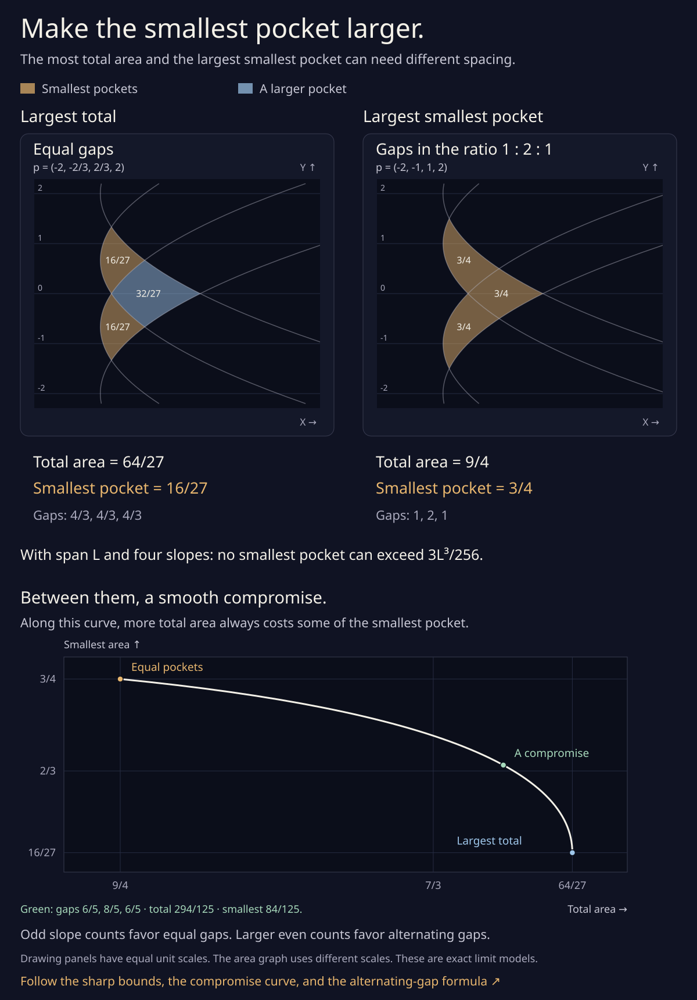

# Make the smallest pocket larger



Equal gaps maximize the **sum** of the bounded pocket areas. They do
not always maximize the **smallest** pocket. With four slopes between
−2 and +2, the equal-gap minimum is 16/27. Moving the two inner slopes
to −1 and +1 makes all three pocket areas 3/4.

The optimum depends on whether the slope count is odd or even. This
note gives a sharp bound and an attaining arrangement for every count
n≥3. As in the [envelope and run calculation](parabolic_pockets.md),
the curves are the complete exact limit parabolas
`Xᵢ=(Y−pᵢ)²/2` at scaled route parameter zero. These optimizations do
not concern faces of a finite orbital drawing.

## State the problem in gaps

Keep the outer slopes fixed, with span L>0, and choose n−2 distinct
interior slopes. Put `gᵢ=pᵢ₊₁−pᵢ>0`, so the n−1 gaps sum to L.
The [consecutive-run formula](parabolic_pockets.md#the-area-of-one-run)
gives the area of each bounded face. If its first and last interior
slopes are pᵢ and pⱼ, its area is

```
Aᵢⱼ = gᵢ₋₁gⱼ [gᵢ₋₁ + 2(gᵢ+⋯+gⱼ₋₁) + gⱼ]/8.
```

An empty middle sum is zero. In particular, the adjacent triangular
pocket has

```
Aᵢᵢ = gᵢ₋₁gᵢ(gᵢ₋₁+gᵢ)/8.
```

We want to maximize `minᵢ≤ⱼ Aᵢⱼ`, allowing all interior slopes to move.
All the results below are unique once the outer slopes are fixed.

## Odd slope counts: equal gaps

Let n=2k+1. There are 2k gaps. Pair them without overlap:

```
(g₀,g₁), (g₂,g₃), …, (g₂ₖ₋₂,g₂ₖ₋₁).
```

At least one pair has sum s≤L/k. Its triangular pocket has area

```
xy(x+y)/8 ≤ s³/32 ≤ L³/(32k³).
```

The first inequality is just `xy≤(x+y)²/4`. Consequently the
smallest face cannot exceed this bound.

Equal gaps `g=L/(2k)` attain it. Every k′-slope run has area k′g³/4,
so no longer run is smaller than a triangular pocket. Thus

```
max smallest area = L³/[4(n−1)³],       n odd.
```

Equality requires all the disjoint pair sums to be L/k and both
gaps in each pair to be equal. Hence every gap must be L/(n−1).

## Four slopes: make all three areas equal

Write the three gaps as l,m,r, with l+m+r=L. The three face areas are

```
T_left  = lm(l+m)/8,
T_right = mr(m+r)/8,
Q       = lr(L+m)/8.
```

First replace l and r by their average a, keeping m fixed. The
smaller triangle cannot shrink, because `x m(x+m)` increases with x
and `a≥min(l,r)`. The quadrilateral cannot shrink either, because
`a²≥lr`. If l≠r, both of these lower quantities grow strictly. An
optimal arrangement must therefore have l=r=a and m=L−2a.

Put z=a/L, with 0<z<1/2. The two distinct areas become

```
T/L³ = z(1−2z)(1−z)/8,
Q/L³ = z²(1−z)/4.
```

For z<1/4, Q is smaller and increases with z. For z>1/4, T is
smaller and decreases with z: its derivative has the sign of
`1−6z+6z²`, which is negative on `[1/4,1/2]`. The sharp maximum is
at z=1/4, where all three areas agree:

```
gaps = (L/4, L/2, L/4),
max smallest area = 3L³/256,       n=4.
```

At L=4, this is the right panel's three 3/4 pockets. Its total area
9/4 is less than the equal-gap maximum 64/27. Neither picture is
better for both objectives.

## Every four-slope compromise

The two optimal arrangements are the ends of a whole curve of
efficient compromises. No point on that curve can improve either
area without reducing the other.

Symmetrizing the outside gaps increases both measures. The total
area gains exactly `(l+r)(l−r)²/32`; the smallest area increases as
in the preceding argument. Thus any efficient arrangement must have
gaps `(a,L−2a,a)`. Write z=a/L again. Its total and smallest areas are

```
B(z) = L³ z(1−z)²/4,
S(z) = min(T(z),Q(z)).
```

Before z=1/4, both B and S increase, so z=1/4 improves both. After
z=1/3, both decrease, so z=1/3 improves both. On the interval
`1/4≤z≤1/3`, the smaller area is T and the two measures move in
opposite directions:

```
S(z) = L³ z(1−2z)(1−z)/8,
B′(z) = L³(1−z)(1−3z)/4 ≥ 0,
S′(z) = L³(1−6z+6z²)/8 < 0.
```

B is strictly increasing on that whole interval despite its zero
derivative at the right endpoint. This identifies every efficient
compromise, including the endpoints. Asymmetric arrangements cannot
add another one, because their symmetric replacements improve both
objectives.

The graph under the two drawings uses L=4. The green point is z=3/10,
with gaps `(6/5,8/5,6/5)`, total area 294/125, and smallest area
84/125. Both coordinates of `(B(z),S(z))` are cubic polynomials in z,
so the whole graph is one exact cubic Bézier, before display rounding.
Its four control points are

```
(9/4,3/4), (7/3,13/18), (64/27,2/3), (64/27,16/27).
```

Only the first and last controls are endpoints of the curve. The two
middle controls set its derivatives. This area plot uses different
axis scales; the two drawings above it retain equal coordinate scales.

The [complete compromise follow-up](parabolic_tradeoff.md) extends
this classification to every slope count. Every even-count frontier
alternates two gap lengths and is also one exact cubic in the area
coordinates. A [six-slope drawing](parabolic_tradeoff.svg) compares
ten named pockets along it.

## Larger even counts: alternate two gaps

Let n=2k+2 with k≥2. Define

```
t = [1+√(k²+k+1)]/k,
a = L/(k+1+kt),
b = ta.
```

The positive root t satisfies `kt²−2t−(k+1)=0` and lies strictly
between 1 and 2. Use the 2k+1 gaps

```
a, b, a, b, …, a, b, a.
```

There are k+1 short gaps and k long gaps. Every adjacent triangular
pocket has the same area

```
T = ab(a+b)/8.
```

No longer run has a smaller area. A longer run whose end gaps differ
has the same ab factor and a strictly larger middle sum. A run whose
end gaps are both a has area at least `a²(a+b)/4=(2/t)T>T`; one
whose end gaps are both b has area at least
`b²(a+b)/4=2tT>T`. This proves that the whole arrangement's smallest
area really is T.

### Why no other gaps can do better

It suffices to bound the adjacent triangles. Put

```
f(x,y) = [xy(x+y)]^(1/3),
f₀ = f(a,b).
```

Apply AM–GM to the three positive quantities
`x/a`, `y/b`, `(x+y)/(a+b)`:

```
f(x,y)/f₀
  ≤ [x/a + y/b + (x+y)/(a+b)]/3
  = [(k+1)x + ky]/L.
```

The last equality follows directly from `kt²−2t−(k+1)=0`.
Reversing the reference pair a,b reverses the coefficients:
`f(x,y)/f₀ ≤ [kx+(k+1)y]/L`.

For arbitrary positive gaps summing to L, apply the first bound to
the pairs starting at even indices and the reversed bound to those
starting at odd indices. Weight the 2k pair inequalities by

```
w₂ⱼ   = k−j,
w₂ⱼ₊₁ = j+1,       j=0,…,k−1.
```

Every weight is positive. Their sum is k(k+1). Every individual gap
has total coefficient k(k+1) on the right: at the ends this is k(k+1)
from a single pair; in the interior the two adjacent coefficients
add to the same value. Consequently

```
Σ wᵢ f(gᵢ,gᵢ₊₁) / [k(k+1)] ≤ f₀.
```

At least one adjacent pair has `f(gᵢ,gᵢ₊₁)≤f₀`. Its triangular
pocket has area at most f₀³/8=T. This is a bound for every choice of
the gaps, and the alternating arrangement attains it. Therefore

```
max smallest area
  = L³ t(1+t) / [8(k+1+kt)³],       n=2k+2≥6.
```

For equality, every positively weighted AM–GM inequality must be an
equality, so each neighboring gap pair is proportional to its
reference a,b or b,a. The connected chain and fixed total L force
the displayed alternating gaps. This proves uniqueness as well.

The four-slope case is exceptional for a reason. Substituting k=1
in this adjacent-triangle optimum gives t=1+√3>2. The quadrilateral
would then be smaller than the triangles. Balancing it too moves
the optimum to t=2, as proved above.

## A few sizes at span four

| Slopes | Optimal gaps, approximately | Largest possible smallest area |
| --- | --- | ---: |
| 3 | 2, 2 | 2 |
| 4 | 1, 2, 1 | 3/4 |
| 5 | 1, 1, 1, 1 | 1/4 |
| 6 | 0.601888306, 1.097167541, …, 0.601888306 | ≈0.140251179876 |
| 7 | Six gaps of 2/3 | 2/27 |
| 8 | 0.464816242, 0.713578345, …, 0.464816242 | ≈0.048856652597 |

For six slopes, equal gaps instead give minimum 0.128. The larger
minimum costs some total area, just as in the four-slope picture.
For odd counts the two objectives share the same equal-gap optimum.

## Why the even-count advantage gets small

For even n≥6, let m=n−1 be the number of gaps. Compare the optimal
minimum with the equal-gap minimum `L³/(4m³)`. Put

```
c = (a+b)/2,       h = (b−a)/2,       u = h/L.
```

There is one more short gap than long gap, so `L=mc−h` and
`c=(L+h)/m`. The normalized minimum is

```
R = T / [L³/(4m³)]
  = (1+u)³ − m²u²(1+u).
```

The optimal ratio gives

```
3 − 2(m²−3)u − 3(m²−1)u² = 0,
u = [m√(m²+3) − m² + 3] / [3(m²−1)],
R = 2(1+u)³/(2+3u).
```

Expanding the positive square root at 1/m²=0 gives
`u=3/(2m²)+O(m⁻⁴)` and therefore

```
R = 1 + 9/(4m²) + O(m⁻⁴).
```

The relative advantage of alternating gaps shrinks quadratically in
the number of gaps. The absolute area gain is
`9L³/(16m⁵)+O(m⁻⁷)`. These are asymptotics in slope count, unrelated
to an orbital drawing's outward offset. No numerical remainder bound
for all finite m is asserted here. The exact program checks the two
stationary identities before printing any approximate areas.

## Reproduce

Only standard runtimes are needed:

```sh
python3 experiments/parabolic_balance.py
python3 experiments/parabolic_pockets.py --write
node experiments/parabolic_pockets_figure.js
```

The balance program checks counts 3 through 20 at two spans, using
exact rational arithmetic for odd counts and four slopes, and exact
quadratic-field arithmetic for the alternating ratios. Order tests
compare rational squares, never rounded radicals. It checks all
run areas, the AM–GM supporting coefficients, positive weights,
span accounting, and cubic rescaling. A separate 474 controls use
rational challengers, exact cubed AM–GM inequalities, four-slope
symmetrization, independent curved integrals, and invalid inputs.
The decimal readouts are illustrations.

Eight further controls bracket the six- and eight-slope optima by
rational square-root bounds at 12, 24, 48, and 96 bits. Each midpoint
gives a rational arrangement with exactly the required span. A fresh
complete line clipping computes all its faces; their smallest areas
lie strictly below the exact algebraic optima. These provide independent
geometric controls near the irrational candidates.

Another 66 exact controls check four-slope symmetrization in both
measures, monotonicity along the compromise, its displayed coordinates,
and invalid parameters. The recorded cubic also agrees with the
independently integrated faces at 37 rational parameters. The proof
of the whole interval is the derivative and dominance argument above.

The bound for every n comes from the argument above; a finite list
of checked slope counts would not prove it. Add `--max-slopes 40` to
check more counts. The [four-slope SVG](parabolic_balance.svg) uses
the freshly checked rational vertices and quadratic paths from the
same record as the other envelope drawings. Its coordinates are
rounded for display. It works without scripts and can be saved.
