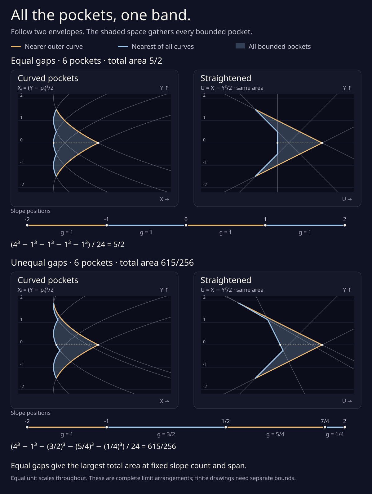
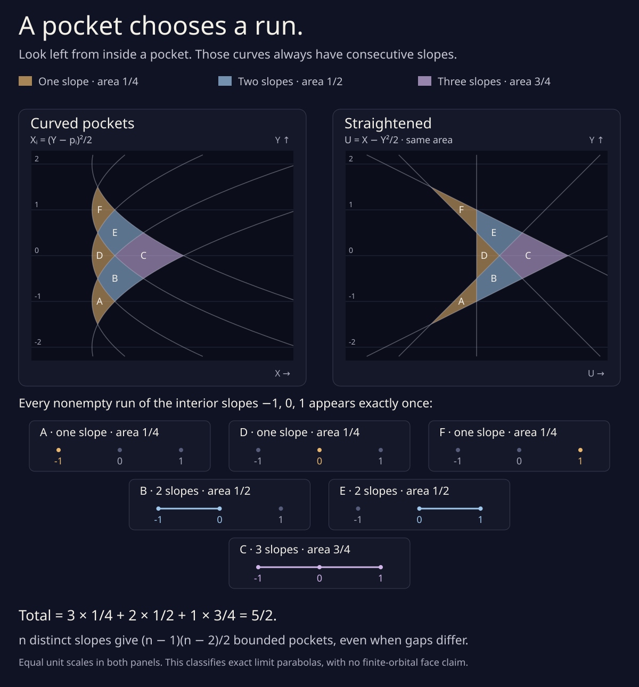

# All the pockets, one band



Five parabolas make six pockets. Instead of adding six separate areas,
follow the two edges of their union. One edge chooses the nearest
parabola; the other chooses the nearer of the two outer ones. The
shaded band between those edges gathers exactly the bounded pockets.

These are the complete **limit arrangements**

```
Xᵢ(Y) = (Y−pᵢ)²/2,       p₀ < p₁ < ⋯ < pₙ₋₁.
```

The labels pᵢ are the angular slopes of the original selected support
graphs. After the common slide `U=X−Y²/2`, these parabolas become
lines with slopes −pᵢ. The [three-branch note](parabolic_triangle.md)
explains how the limit arises. Here the scaled route parameter is
zero throughout. These diagrams do not assert face counts for a
finite orbital drawing.

## Follow the nearest slope

At height Y, the horizontal coordinate of the nearest parabola is
half the squared distance to the nearest slope. Using just the two
extreme slopes gives the other envelope:

```
inner(Y) = ½ minᵢ (Y−pᵢ)²,
outer(Y) = ½ min((Y−p₀)², (Y−pₙ₋₁)²).
```

The [earlier band argument](parabolic_triangle.md#more-than-three-slopes-add-the-gap-cubes)
shows that the bounded faces fill `inner < X < outer`, apart from
their edges. Its width is unchanged by the horizontal slide. The
white dashed slices in the picture have the same lengths before
and after straightening; all four plots use the same unit scales.

Write `L=pₙ₋₁−p₀` and `gᵢ=pᵢ₊₁−pᵢ`. The integral of half the
squared nearest-endpoint distance over a gap of length g is g³/24.
Thus the complete band has area

```
B = (L³−Σgᵢ³)/24.
```

At fixed n and L, equal gaps give the largest B. The pictured equal
five-slope set has gaps `(1,1,1,1)` and area 5/2. The other set has
gaps `(1,3/2,5/4,1/4)` and area 615/256. Both have six pockets;
spacing changes their areas, rather than their number.

## Where should the next curve go?


Keep the old slopes fixed and insert one new slope into a gap of
length g. If it splits that gap into lengths a and b, with a+b=g,
only that gap's cube changes. The added area is exactly

```
ΔB = (g³−a³−b³)/24
   = abg/8
   = g³/32 − (g/8)(a−g/2)².
```

The new band contains the old one: adding a candidate can only
reduce the nearest-slope distance. The green patch in the middle
panel is precisely the extra band, not an entire newly labelled face.

For a fixed gap, the best insertion is its midpoint. Among all gaps,
a widest one gives the largest gain, g³/32. If several gaps are widest,
each of their midpoints is optimal under this constraint.

This single addition need not produce the best complete arrangement.
Starting from slopes `(−2,0,2)`, either insertion at −1 or +1 adds
1/4, giving total area 9/4. Four equally spaced slopes instead give
64/27. Reaching them requires moving old interior slopes too.
Repeatedly making the best insertion can therefore miss the equal-gap
maximum at an intermediate slope count.

The [sideways-slide variation](shifted_parabolas.md) explains why the
midpoint rule depends on the original quadratic intercepts. It gives
a secant-variance formula for strictly convex intercepts and a cubic
example whose best insertion lies away from the midpoint.

## Each pocket chooses a consecutive run



There is also a way to identify each pocket individually. Stand at a
point `(X,Y)` in the band and ask which parabolas lie to its left:

```
X > (Y−pᵢ)²/2  ⇔  |Y−pᵢ| < √(2X).
```

Those slopes form a nonempty consecutive run. It contains neither
extreme slope, because the point lies left of both extreme curves.
The run cannot change while moving inside a face: changing it would
cross one of its boundary curves.

Conversely, take any nonempty run of interior slopes, from pᵢ to pⱼ.
Put

```
a = pᵢ₋₁,       b = pᵢ,       c = pⱼ,       d = pⱼ₊₁,
a < b ≤ c < d.
```

The corresponding face lies to the right of the b and c curves and
to the left of the a and d curves. All other inequalities follow
from the slope order. For example, at `Y=(b+c)/2`, b and c are closer
than a and d; every interior slope between b and c is at least as
close. There is a strictly positive horizontal interval for X with
exactly this run.

After straightening, these inequalities are open half-planes. Their
intersection is convex and therefore is one face. If b=c it is a
triangle. If b<c it is a quadrilateral. Every run occurs exactly once.
For n≥2 distinct slopes, the complete arrangement therefore has

```
(n−1)(n−2)/2 bounded pockets:
  n−2 straightened triangles,
  (n−2)(n−3)/2 straightened quadrilaterals.
```

This count does not require equal spacing. The slide preserves the
faces and their areas, while bending their edges.

## The area of one run

Two straightened branches with slope labels u and v meet at

```
(U,Y) = (−uv/2, (u+v)/2).
```

For b<c, the quadrilateral vertices, in cyclic order, are the
crossings `(a,c), (a,d), (b,d), (b,c)`. For b=c, use the three
vertices `(a,b), (a,d), (b,d)`. Taking their shoelace areas gives
one formula covering both cases:

```
areaᵢⱼ = (b−a)(d−c)(c+d−a−b)/8.
```

Equivalently, put `l=b−a`, `m=c−b`, and `r=d−c`. Then
`areaᵢⱼ=lr(l+2m+r)/8`. The three-slope formula is the case m=0.
The independent calculation also integrates the actual curved edges,
using the primitive `Y³/6−pY²/2+p²Y/2`. It finds exactly this same
area for every face.

If every adjacent gap is g, a run of k slopes has m=(k−1)g, so

```
area of a k-slope run = kg³/4,
number of such runs = n−1−k,       1 ≤ k ≤ n−2.
```

For the five-slope picture, three runs have area 1/4, two have area
1/2, and one has area 3/4. Their sum is 5/2. More generally,

```
Σₖ (n−1−k)kg³/4
  = n(n−1)(n−2)g³/24
  = (L³/24)[1−1/(n−1)²].
```

The individual-pocket calculation thus recovers the earlier total
without the envelope integral.

The [smallest-pocket follow-up](parabolic_balance.md) asks a different
optimization question. Equal gaps maximize the smallest pocket for
odd slope counts; even counts instead favor alternating gaps. Four
slopes give the particularly simple ratio 1:2:1, with three equal
pockets. A [fourth drawing](parabolic_balance.svg) compares that
arrangement with the largest-total one.

## Reproduce

Only standard Python and Node runtimes are needed:

```sh
python3 experiments/parabolic_pockets.py
python3 experiments/parabolic_pockets.py --write
node experiments/parabolic_pockets_figure.js
```

An ordinary Python run recomputes and compares the
[rational illustration record](parabolic_pockets.json). It clips a
box containing all line intersections, discards cells touching its
boundary, and compares every remaining polygon with a consecutive-run
face. Exact curved integrals, shoelace areas, envelope integrals,
gap cubes, and equal-gap deficits agree. The 26 controls include two
through twelve equally spaced slopes, unequal examples, translations,
rescalings, reversals, and invalid inputs. Another 101 controls check
insertion gains, midpoint deficits, independent full face sums, and
invalid insertions.

The generator draws parabolas with quadratic Bézier paths and rounds
the SVG coordinates. Rendered paths do not enter exact area decisions.
All four drawings work without scripts and can be saved directly:
[the envelope band](parabolic_envelope.svg),
[the new curve](parabolic_insertion.svg), and
[the consecutive runs](parabolic_runs.svg), plus
[the balanced pockets](parabolic_balance.svg).
