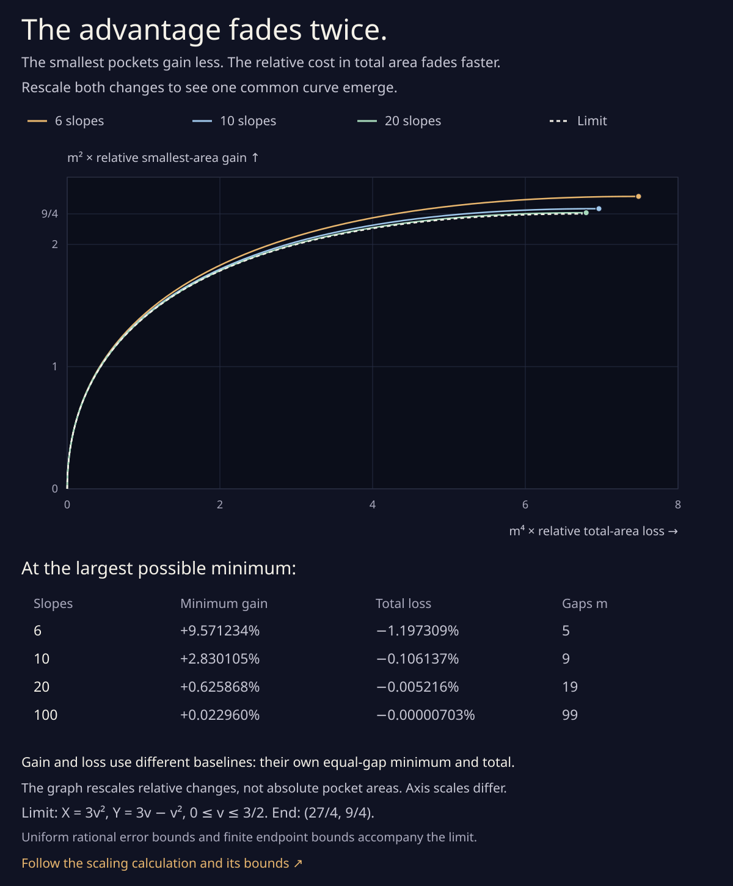

# The advantage fades twice

The [complete compromise curve](parabolic_tradeoff.md) alternates two
slope gaps. As the even slope count increases, the best alternation
becomes subtle. Its **relative** improvement in the smallest pocket
fades quadratically in the number of gaps. Its **relative** cost in
total area fades quartically.

After rescaling both changes, the complete efficient curves approach
one simple quadratic arc. Explicit rational bounds control every
slope count, including the small tail beyond their common parameter
window.



This is a limit in **slope count**, for complete exact arrangements
of `Xᵢ=(Y−pᵢ)²/2`. It is separate from the orbital drawing's
outward-offset limit. Each percentage uses its own equal-gap
baseline; the two baseline areas are different.

## Rescale both changes

Let m=n−1 be the odd number of gaps, with m≥5, and keep outer
slope span L fixed. As in the [frontier proof](parabolic_tradeoff.md),
put `u=(b−a)/(2L)`. The equal-gap areas are

```
B₀ = L³(1−1/m²)/24,       S₀ = L³/(4m³).
```

The exact relative loss of total and gain of minimum are

```
δ = (B₀−B)/B₀ = 3u²+2u³,
ρ = (S−S₀)/S₀ = 3u−(m²−3)u²−(m²−1)u³.
```

Use the scaled parameter and coordinates

```
v = m²u,       X = m⁴δ,       Y = m²ρ.
```

Substitution gives

```
Xₘ(v) = 3v² + 2v³/m²,
Yₘ(v) = 3v−v² + v²(3−v)/m² + v³/m⁴.
```

The finite efficient arc starts at v=0. Its final parameter vₘ is
the positive root of

```
Dₘ(v) = 3−2(1−3/m²)v−3(1/m²−1/m⁴)v² = 0.
```

Indeed `Yₘ′=Dₘ`, so the minimum increases until that endpoint.
Xₘ also increases. The four-slope exception is outside this note:
its quadrilateral ends the efficient interval before the triangular
stationary point.

## One limiting parabola

For each fixed v, the two scaled coordinates tend to

```
X∞(v) = 3v²,
Y∞(v) = 3v−v²,       0 ≤ v ≤ 3/2.
```

The limiting endpoint is `(27/4,9/4)`. Eliminating v gives

```
(X+3Y)² = 27X.
```

Thus the common curve really is a parabola in the two scaled area
coordinates. Both coordinates are quadratic in v. Its exact
quadratic Bézier controls are

```
(0,0), (0,9/4), (27/4,9/4).
```

The middle control lies off the curve; it specifies its initial
vertical and final horizontal tangent. The finite curves are cubic,
with algebraic final parameters. Their exact controls come from
an affine rescaling of the already certified area cubics.

## Uniform errors on a common window

For every m≥5 and every `0≤v≤3/2`,

```
0 ≤ Xₘ(v)−X∞(v) ≤ 27/(4m²),
0 ≤ Yₘ(v)−Y∞(v) ≤ [27/(8m²)](1+1/m²).
```

The first bound is `2v³/m²≤27/(4m²)`. For the second,
`v²(3−v)` increases on this interval to 27/8, and v³ has the
same maximum. These are uniform bounds over an interval of v,
not merely checks at sampled parameters.

This common window belongs to every finite efficient arc. To see
that, and to control the remaining short tail, we bound vₘ next.

## Finite endpoint bounds

Put r=1/m², so `0<r≤1/25`. Direct substitution gives

```
Dₘ(3/2) = (9r/4)(1+3r) > 0,
Dₘ((3/2)(1+r)) = (3r/4)(−1+3r+9r²+9r³) < 0.
```

The last sign follows from
`3r+9r²+9r³≤2109/15625<1`. Dₘ is strictly decreasing for
v≥0. Its positive root therefore satisfies the sharp-enough bracket

```
3/2 < vₘ < (3/2)(1+1/m²) ≤ 39/25.
```

For the final horizontal coordinate,

```
Xₘ(vₘ)−27/4
 = 3(vₘ−3/2)(vₘ+3/2) + 2vₘ³/m²
 < [3(3/2)(39/25+3/2) + 2(39/25)³]/m²
 < 22/m².
```

For the final vertical coordinate, Yₘ increases up to vₘ, so
`Yₘ(vₘ)≥Yₘ(3/2)>9/4`. Also

```
Yₘ(vₘ)−9/4
 = −(vₘ−3/2)² + vₘ²(3−vₘ)/m² + vₘ³/m⁴
 < [(39/25)²(3/2) + (39/25)³/25]/m²
 < 4/m².
```

Consequently, for **every odd m≥5**, the largest-minimum endpoint
obeys

```
27/(4m⁴) < δ_end < 27/(4m⁴) + 22/m⁶,
9/(4m²)  < ρ_end < 9/(4m²)  + 4/m⁴.
```

These are explicit signed finite remainders. They strengthen the
asymptotic descriptions and do not rely on rounded radicals.

The whole tail `3/2≤v≤vₘ` stays inside the rectangle

```
27/4 < Xₘ(v) < 27/4+22/m²,
9/4  < Yₘ(v) < 9/4+4/m².
```

Both coordinates increase on the finite arc, and their values at
3/2 already exceed the limiting endpoint's values. Together with
the common-window bounds, this proves convergence of the **complete**
finite arcs, not just their endpoints. More concretely, every point
of either arc is within 22/m² in each coordinate of some point of
the other, comparing the finite arc with the limiting one.

## What the percentages mean

At six slopes, the best minimum improves by about 9.571234% while
total area falls about 1.197309%. At twenty slopes those changes
are about 0.625868% and 0.005216%. At one hundred they are about
0.022960% and 0.00000703%. The plot's table uses these actual finite
values, not only their leading approximations.

The relative gains and losses have different denominators. In
absolute area at fixed L,

```
S_end−S₀ = 9L³/(16m⁵) + O(m⁻⁷),
B₀−B_end = 9L³/(32m⁴) + O(m⁻⁶).
```

So the **absolute** gain in the smallest area decays faster than
the absolute total cost. The quartic-versus-quadratic comparison
above concerns percentages of their respective baselines. The
figure states that distinction explicitly.

## Reproduce

```sh
python3 experiments/parabolic_tradeoff_limit.py
python3 experiments/parabolic_tradeoff_limit.py --write --figure
```

The standard-library program checks 48 exact endpoint enclosures
through one hundred slopes, 1,776 rational common-window controls,
six fresh complete clipped arrangements, six invalid inputs,
111 exact finite-cubic matches, and 37 exact limit-quadratic matches.
The independent line arrangements compare both scaled coordinates
with actual face totals and minima. Exact quadratic-field signs
handle the finite endpoints; floats are used only for readouts and
SVG coordinates.

The JSON record keeps all displayed controls and endpoint values
as exact rational-plus-radical numbers. The standalone SVG has no
scripts or external assets and retains an absolute proof link when
saved. The written polynomial inequalities prove the uniform bounds
for all counts; the finite list audits their implementation.
