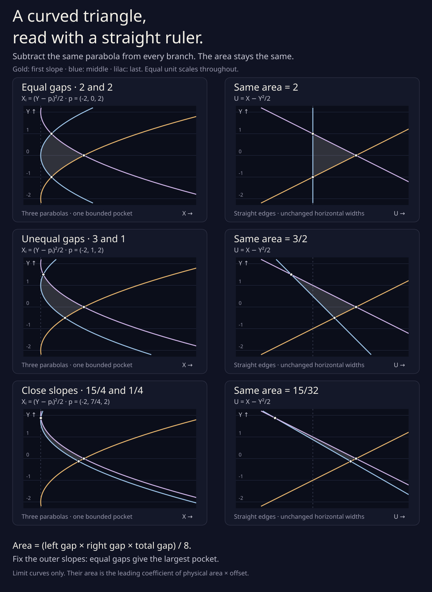
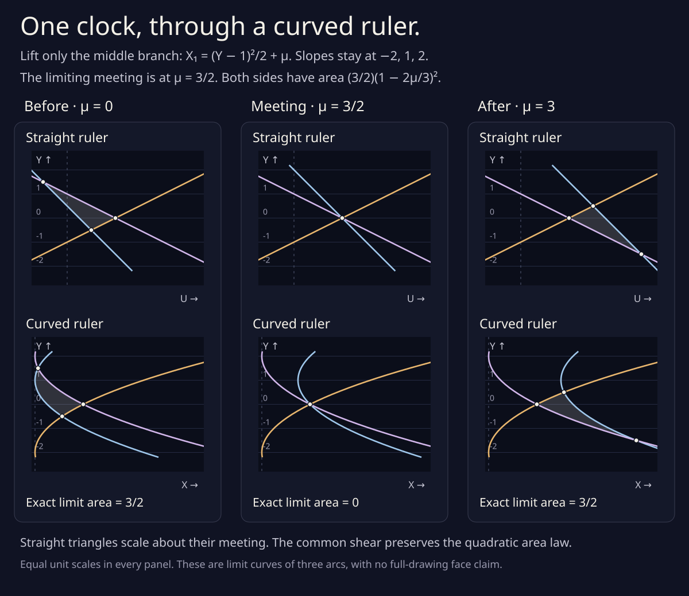

# A curved triangle, read with a straight ruler



Three parabolas can enclose a pocket with exactly the area of a straight
triangle. Slide every horizontal row by the same amount, `−Y²/2`.
The edges straighten. Every row keeps its width, so the area stays
the same.

This picture follows the [small triangle left at a front triple](radial_limit.md#the-triangle-left-at-the-front-triple).
That calculation used equally spaced slopes. Here the slopes can have
any three distinct values. The two outer slopes in the picture stay at
−2 and +2; moving the middle one toward a neighbor makes the pocket
thinner. All six panels use the same unit scale on both axes.

These are **limiting curves of three selected branches**, after
magnifying a distant plane drawing. The formulas below are exact for
those limit curves. A finite drawing needs its own error bounds, and
calling the pocket a face of a larger drawing requires excluding other
branches.

## Where the three parabolas come from

At an ordinary front triple, three support graphs meet at angle α₀,
height h₀, and route parameter s₀. Write their angular slopes pᵢ and
route derivatives bᵢ there. Rotate coordinates so α₀=0, move outward
by distance M, and look at route parameter `s=s₀+μ/M`:

```
N(θ) = (cos θ, sin θ),
qᵢ,M = (hᵢ−M)N + hᵢ,θ N′.
```

Translate the common base point and stretch only the horizontal
coordinate:

```
X = M(qₓ+M−h₀),       Y = qᵧ.
```

On branch i, put θ=σ/M. Taylor expansion on compact σ and μ windows
gives

```
X → σ²/2+bᵢμ,       Y → pᵢ−σ.
```

Eliminate σ. The three limit curves are

```
Xᵢ(Y,μ) = (Y−pᵢ)²/2+bᵢμ.
```

The stretch multiplies physical area by M. An area A in this picture
therefore means `A/M` to leading order in the unscaled drawing.
The equal scales in the panels refer to the stretched coordinates,
not to the thin original pocket.

## A horizontal slide that preserves area

Use the same change of coordinates on all three branches:

```
U = X−Y²/2,       Y = Y.
```

Its inverse is `X=U+Y²/2`. Its Jacobian determinant is one everywhere.
Equivalently, at every fixed Y it translates both ends of a horizontal
slice by the same amount. Thus it is a bijection that preserves area.
It turns the three parabolas into three lines:

```
Uᵢ(Y,μ) = −pᵢY+pᵢ²/2+bᵢμ.
```

Three distinct slopes give three pairwise transverse lines. Unless
they all meet at one point, they bound one straight triangle. Applying
the inverse slide gives one bounded curved pocket between the three
parabolas. This statement concerns these three full limit curves.

At μ=0 the crossing of branches i and j is particularly simple:

```
Yᵢⱼ = (pᵢ+pⱼ)/2,
Xᵢⱼ = (pᵢ−pⱼ)²/8,
Uᵢⱼ = −pᵢpⱼ/2.
```

Taking the determinant of two edges gives the area of either picture:

```
V = |(p₀−p₁)(p₀−p₂)(p₁−p₂)|,
area = V/8.
```

The program checks this in three separate ways: exact polynomial
integration of the curved boundary, straight-vertex shoelace area,
and the earlier [determinant formula for three moving lines](triple_area.md).
It also solves the lines independently in the radial graph's `(ζ,Z)`
coordinates. Here `ζ=−Y` and `Z=U`, consistent with the earlier radial
area calculation.

## Equal gaps give the largest pocket

Sort the slopes. Put `g=p₁−p₀>0` and `L=p₂−p₀>g`. Then

```
area = Lg(L−g)/8
     = L³/32 − (L/8)(g−L/2)².
```

For fixed outer slopes, the largest area is **L³/32**, reached only
when the middle slope is halfway between them. The three rows in
the drawing have L=4 and areas

| Slopes | Adjacent gaps | Area |
| --- | --- | ---: |
| −2, 0, 2 | 2 and 2 | 2 |
| −2, 1, 2 | 3 and 1 | 3/2 |
| −2, 7/4, 2 | 15/4 and 1/4 | 15/32 |

As either gap tends to zero the area tends to zero. At zero gap two
parabolas coincide, so there is no ordinary three-branch configuration.
The picture's last row keeps both gaps strictly positive.

## The velocities choose one clock



The three route rates bᵢ determine one polynomial of degree at most two
in slope:

```
bᵢ = A pᵢ²+B pᵢ+C.
```

One way to find A is the second divided difference:

```
A = [(b₂−b₁)/(p₂−p₁) − (b₁−b₀)/(p₁−p₀)] / (p₂−p₀).
```

Substitute the polynomial into the straightened lines:

```
Uᵢ = −pᵢ(Y−Bμ) + (1+2Aμ)pᵢ²/2+Cμ.
```

Ordinariness of the front event is exactly A≠0. Indeed its event
Jacobian has determinant

```
det J = A(p₀−p₁)(p₀−p₂)(p₂−p₁).
```

All three straight lines meet precisely at

```
c = −1/(2A),       μ=c,
(U*,Y*) = (cC,cB).
```

This is the [earlier drift coefficient](radial_limit.md#every-ordinary-front-triple-has-a-nonzero-leading-time-shift)
in a different form. The leading polar-angle shift is `a₁=−cB`,
and the leading height shift is `cC`. In the plane the local event
occurs at `s=s₀+c/M+O(M⁻²)` for sufficiently large M. A>0 puts it
before the front meeting; A<0 puts it after.

The entire straight triangle at parameter μ is the triangle at zero
scaled about `(U*,Y*)` by factor `1−μ/c`. Each of its vertices is
affine in μ and reaches the same point at μ=c. Hence

```
area(μ) = (V/8)(1−μ/c)²
        = (V/8)(1+2Aμ)².
```

The curved triangle has this same area. It is the image of that
homothety through the common nonlinear slide. Its appearance need
not be a scaled copy, as the lower panels show.

For the pictured slopes `(−2,1,2)` and rates `(0,1,0)`,
`A=−1/3`, `B=0`, `C=4/3`, and `c=3/2`. The meeting is at `(X,Y)=(2,0)`.
At μ=0 and μ=3 both areas are exactly 3/2. At μ=3/2 the **limit**
triangle is a point. A finite-offset triangle at the leading clock
need not have exactly zero area: its actual event has higher-order
time corrections.

The [retiming follow-up](parabolic_retiming.md) computes the next clock
coefficient. Matching one more clock term gains two powers of distance
in the residual area. A generic pocket at the leading corrected clock
has order 1/M³; the symmetric polynomial model cancels that term too,
leaving order 1/M⁵. Fresh exact integrals enclose four finite examples
of the latter, including M=10²⁰.

If A=0, the rates are affine in slope. The straight triangle simply
translates by `(Cμ,Bμ)` and keeps its initial area. There is no finite
limiting triple clock in this case; the ordinary-event formula must
not divide by zero.

## Reproduce

Only standard Python and Node runtimes are needed:

```sh
python3 experiments/parabolic_triangle.py
python3 experiments/parabolic_triangle.py --write
node experiments/parabolic_triangle_figure.js
```

The [rational record](parabolic_triangle.json) stores the illustrated
slopes, route rates, interpolation coefficients, clocks, vertices, and
areas. Fresh exact geometry must match it on an ordinary run.

Exact controls cover independently computed boundary integrals and
line areas, several signs and orders of the rates, relabelings, common
slope shifts, common route rates, the concurrent limit, the fixed-span
maximum, affine-rate degeneracy, and invalid inputs. Numerical controls
use different smooth support graphs with nonzero height, second
derivatives, and mixed derivatives. Separate Newton solves and sampled
boundary areas follow nine unequal-slope finite-offset pockets toward
their exact limit areas. These numerical checks do not supply an
all-offset enclosure or a whole-route event threshold.

The SVG generator uses quadratic Bézier arcs for the parabolas and
straight segments for their images. Their coordinates are rounded
for display. Neither SVG paths nor numerical samples enter an exact
area decision. Both figures remain usable without scripts and can be
saved directly: [the gap comparison](parabolic_triangle.svg) and
[the clock comparison](parabolic_clock.svg).
