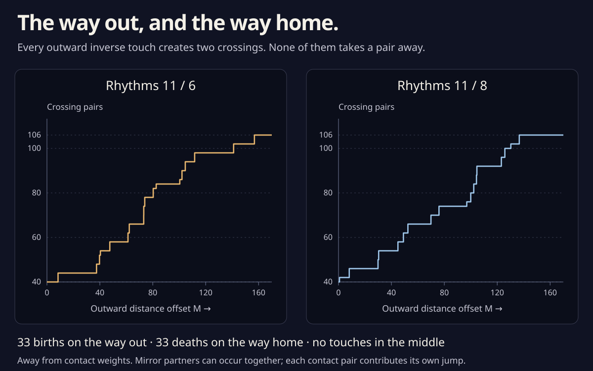

# The way out, and the way home

The [positive-front construction](positive_front.md) gives a regular
route from 11 / 6 to 11 / 8 without direct self-tangencies. Its middle
part, at a large common offset, actually avoids **both** kinds of touch.
All the inverse touches occur while moving the endpoints outward or
bringing the second one home.

There are exactly **33 inverse contact pairs on each outward offset
leg**. Every one creates two crossings. Reversing the second leg turns
its births into deaths. After an arbitrarily small generic perturbation,
the complete route therefore has **66 inverse touches and no direct
touches**. This is a count for this construction, not a minimum.
For a sufficiently distant version of this construction, a
[radial-word argument](radial_word.md) now counts **722 plane triples
in the middle** and gives **at least 936 over the complete route**.
A [selected positive-passage follow-up](offset_positive.md) raises the latter
bound to **992** by forcing 18 and 10 positive passages on the outward legs.
The two offset legs' exact triple counts remain open. No numerical
offset threshold is supplied for the stronger triple conclusion.

The [interactive circle study](parallel_offset.html) follows one selected
ordinary triple, with a certificate covering its full viewing window.



The graph counts transverse crossing pairs **away from the touch
weights**. A higher transverse meeting can put several crossing pairs
at one plane point; it does not alter this pair count. Its horizontal
positions are rounded from the [certified intervals](parallel_offset_events.json).

## No touch in the middle

Keep the left-normal coordinates `q = hN+h′N′`. After subtracting a
common constant M from every support distance,

```
q_M = (h−M)N+h′N′,
q_M′ = (h+h″−M)N′.
```

The earlier construction has negative velocity coefficient and embedded
Legendrian lift, so it has no direct touch. If two opposite-facing
visits coincided, their normals would be N and −N. Taking the normal
component of their equality would give

```
h₁+h₂ = 2M.
```

Before smoothing the constructed middle family has `|h|≤450`; choose
the C² smoothing with `|h|<451`. Its offset is M=10⁹.
That equality is impossible. Thus the middle has neither kind of
self-tangency. A small generic perturbation can retain these strict
properties. This does not remove the touches on the offset legs.

## An outward parallel offset only creates inverse pairs

At either original endpoint, `h+h″=−ρ`, with ρ strictly positive.
Hence `q_M′=−(ρ+M)N′` is nonzero for every M≥0, and its curvature
stays positive. The lifted front remains embedded: a common offset
changes neither height differences nor slopes at equal normals.
There is no direct touch at any outward offset.

For a possible inverse touch, choose one normal direction θ and the
opposite direction θ+π. Follow the two selected visits continuously
in their local normal charts and write

```
H(θ) = h₁(θ)+h₂(θ+π).
```

The two offset points agree exactly when

```
H(θ)=2M,       H′(θ)=h₁′+h₂′=0.
```

At a positive-offset solution,

```
H″ = −ρ₁−ρ₂−H = −ρ₁−ρ₂−2M < 0.
```

Thus every positive critical value is a strict, nondegenerate maximum.
There are finitely many such pairs on the compact angular cover: an
accumulation would give a nonisolated zero of H′ at H≥0, contradicting
that same strict inequality. The finitely many local charts glue
cyclically; unordered visit pairs are counted once.

The contact is ordinary and its opening parameter is transverse. In
coordinates tangent and normal to the first branch, let Δ be the
increase of M beyond contact. Positive curvature makes the two local
graphs bend toward opposite sides. Their leading separation is

```
(κ₁+κ₂) X²/2 − 2Δ,       κ₁,κ₂ > 0.
```

For Δ<0 there is no nearby crossing, and for Δ>0 there are two.
Every outward inverse event is therefore a **birth**, never a death.
Also `|h|≤450` confines them all to M≤450. No sampled event search is
used for these statements.

## Why the crossing count eventually equals the front count

For M>450, the position never reaches the origin. Write α for the
continuous polar angle of −q_M. Then

```
α = θ − atan(h′/(M−h)),
α′ = (h−M)(h+h″−M)/|q_M|² > 0.
```

It makes eleven turns, so each polar direction has exactly eleven
radial visits. Their radial deficits

```
D_M(α) = M−|q_M|
```

converge to the support front h in C¹ as M→∞. To see the derivative
as well as the value, use

```
dD_M/dα = h′ |q_M|/(M−h) → h′.
```

All endpoint h derivatives are bounded on their finite angular covers,
and α tends to θ in C¹, so the convergence is uniform on all strands.
The endpoint fronts have exactly 106 transverse crossings and no
higher meeting. C¹ closeness preserves those simple crossings: a
small neighborhood of each root has a strictly signed derivative of
its height difference, and the compact complement has a nonzero
height gap. Thus for sufficiently large M the plane has exactly
**106 transverse crossing pairs**, as well as distinct crossing points.

For every M>450 the offset curve has no direct touch and, by
`h₁+h₂=2M`, no inverse touch either. Its pair count cannot change there;
transverse triple passages merely relocate its three persistent pairs.
Consequently the pair count is 106 for **every** M>450, although this
argument does not exclude higher transverse meetings at particular
finite offsets.

The fresh smooth proofs give **40 crossings** at each original endpoint.
Only births can change that count along an outward offset. Hence

```
number of inverse contact pairs = (106−40)/2 = 33.
```

This is an analytic corollary of the complete endpoint plane and front
censuses. It is not a new exhaustive product-box search for offset
events. The two input counts have independent rational certificates.

## All 66 event pairs have rational boxes

The count can be complemented with certified locations. For original
positions q(t),q(u), put `v=q′(t)`, `w=q′(u)`, `A=q″(t)`, `B=q″(u)`,
and `δ=q(t)−q(u)`. Solve

```
F(t,u) = (det(v,w), δ·v) = (0,0).

DF = [ det(A,w)       det(v,B) ]
     [ v·v+δ·A          −w·v  ].
```

Multiply the Jacobian columns by the rational circle-chart factors
`2/(1+s²)`. Interval Fourier jets then give entirely rational F and DF.
At each suggested pair, a square of chart radius **10⁻¹¹** is mapped
strictly inside itself by `x↦x−RF(x)`, with contraction norm below
**10⁻⁶**. This certifies existence and uniqueness.

Further interval tests prove `v·w<0` and `δ·Jv>0`. The velocities
are opposite and the chord points along the first left normal, giving
the **positive** offset

```
M = |δ|/2,
contact point = (q(t)+q(u))/2.
```

Rational square-root bounds enclose each offset in an interval narrower
than **10⁻⁴**. There are 33 certified distinct unordered pairs per
endpoint; **528** pairwise box comparisons prove their distinctness.
Since the independent analytic theorem gives exactly 33, the certified
list is complete. Numerical hints suggest centers but neither prove
the count nor exclude any other location.

Reflection sends a circle coordinate s to `(1−s)/(1+s)` and reverses
the visit order. The verifier maps each tiny fixed-point enclosure
inside its unique mate's larger contraction box. By uniqueness,
the two roots are exact reflections and their M values agree. This
identifies **15 reflected pairs and 3 mirror-fixed events** per
endpoint, at **18 strictly ordered weights**. Different weight groups
have disjoint rational intervals; close decimal agreement is not used
to identify partners. All positive contacts lie below M=157.

### A third branch is excluded at every contact

Each certified contact now has an additional whole-orbit cover. Use
`q_M(t)=q(t)−M Jq′(t)/|q′(t)|`. Interval Fourier jets and outward
dyadic square-root bounds enclose the entire shifted arc, for the full
certified M interval. The original uniform `775≤|q′|≤2305` bound
sharpens broad interval norms. Every arc outside two admitted visit
slots is separated from the contact's full position box in at least
one coordinate. Subdivision continues until that strict separation
has been proved everywhere.

Inside each admitted slot, one original velocity component has a fixed
nonzero sign. Positive curvature gives

```
q_M′(t) = (1+Mκ(t)) q′(t),       κ(t)>0,
```

so that coordinate of the offset curve is strictly monotone too.
Each slot supplies at most one visit to the contact. Together with the
two certified root visits, this proves **exactly two branches** at every
contact point, with no third branch. The cover is uniform over its
small certified M interval, not merely at the rounded event weight.

The ordinary inverse contacts are therefore isolated from every other
branch. Their covers do not classify transverse triple passages elsewhere
in the family. Small generic perturbations preserve these nondegenerate
pair contacts and separate their simultaneous times and any unrelated
events, while strict regularity and the absence of direct touches remain
open. The first leg then has 33 ordinary inverse births, the reversed
second leg 33 ordinary inverse deaths, and the middle has no touches.
This proves the stated **66-touch generic route**. Its middle keeps
106 transverse crossing pairs throughout; its triple events may put
three of those pairs at a common point.

## One selected offset triple

The full triple census remains open, but one ordinary passage on the
11 / 6 outward leg now has a separate local certificate. For three
original points q₀,q₁,q₂, let P be their circumcenter. It is rational
in the point coordinates whenever their triangle is nondegenerate.
Solving the three equations `(qᵢ−P)·qᵢ′=0` makes the common circle
tangent to all three branches. Positive dot products with their left
normals select a positive outward offset.

A rational chart cube of radius **10⁻¹³**, with contraction norm below
**10⁻⁵**, contains exactly one such solution in the selected neighborhood.
It gives

```
10.17121 < M < 10.17123,
143.9662 < P_x < 143.9664,
91.0882 < P_y < 91.0884.
```

All three tangents differ. The four-variable Jacobian of the equal-offset-
point equations is separated from zero, proving transverse unfolding.
Another **415 rational arcs** exclude every fourth branch; three admitted
monotone slots contain exactly the three certified visits. Thus this
really is an ordinary triple passage. Nine rational central-difference
comparisons audit the circumcenter Jacobian. Run
`python3 experiments/parallel_offset_triple.py` to repeat the proof.
This is a selected event, not a complete count or a classification of
the rest of either offset leg. The [viewer](parallel_offset.html) uses
rounded coordinates from the [rational event record](parallel_offset_triple.json).

### One triple in the viewer's entire room

The fixed close-up is a square of half-width one, centered on the
certified meeting. Its offset slider stays within **3/20** of that
meeting's offset. Enlarge the rational meeting-point and offset intervals
by those amounts, outward, so they contain the full numerical controls.
Another whole-orbit cover supplies **445 rational arc exclusions**,
uniform in both coordinates and the offset. Only the same three
parameter slots remain, each of rational circle-chart radius **1/1000**.
Each is strictly monotone in its x coordinate throughout the controls.

The possible events in this room can now be classified completely.
For three shifted points solve the four equations

```
G = (q_M(t₀)−q_M(t₁), q_M(t₀)−q_M(t₂)) = 0.
```

In rational chart variables, its time columns are the appropriate
`(1+Mκ)q′ · 2/(1+s²)` components. Its last column is `N_other−N₀`.
Square-root interval bounds make all entries rational enclosures.
The program checks sixteen entries against exact rational central
differences as supplementary implementation controls.

Start with the **entire product** of the three admitted slots and the
full offset interval. Choose one fixed rational center c and a rational
matrix R approximating its Jacobian inverse. Every zero x must satisfy

```
x−c ∈ −R G(c) + [I−R DG(X)] (X−c).
```

Intersect X with this enclosure and round outward to dyadics. Repeat.
The derivative enclosure always covers the convex hull of X and the
**fixed center c**, even if a narrowed X ceases to contain c. Without
that hull, the mean-value step would not be justified.

After **nine** rounds, the derivative norm is below **1/1000**.
There is at most one zero in that final box, and every zero of the full
original product lies there. The separate small circle contraction
already proves that a zero exists. Thus there is exactly **one triple
in the viewing square over the entire slider interval**. This does not
assert one triple on the whole curve during that interval.

Finally split each admitted slot into eight cells. All **192** pairwise
velocity determinant comparisons have strict fixed signs, over all
three pairs of slots. The positive offset speed factor preserves those
directions. The slots' monotone coordinates exclude equal-point returns
within one slot; their pairwise transversality excludes a touch between
slots. No other branch enters the square. Consequently this complete
viewing window has **no self-tangency**, in addition to its one ordinary
triple passage.

### The triangle area depends only on three directions

Put δ=M−M* at the certified event. The
[ordinary triple area theorem](triple_area.md) gives the small curved
triangle's area on both sides:

```
A(δ) = K δ² + O(|δ|³),       K>0.
```

For a parallel offset, K has a particularly simple formula. At the
event write Nᵢ for each unit left normal. Its unit travel tangent is
`Tᵢ=−JNᵢ`, and its motion as M changes is `Wᵢ=−Nᵢ`. Thus
`det(Tᵢ,Wᵢ)=−1`. Set

```
d₀₁ = det(N₀,N₁),   d₁₂ = det(N₁,N₂),   d₂₀ = det(N₂,N₀),
S = d₀₁+d₁₂+d₂₀.

K = S² / (2 |d₀₁ d₁₂ d₂₀|).
```

This follows by substituting the unit tangents and normal motions into
the earlier three-line area formula. Rescaling any branch velocity by
its positive speed does not change that line triangle. Consequently
the leading area depends **only on the three directions**, with no
curvature or speed term. Curvature affects the higher-order correction.
Geometrically, the leading three sides are the lines
`Nᵢ·(X−P)=−δ`, all a signed distance −δ from the meeting point.

The refined rational root box and interval unit normals enclose

```
3.845697440 < K < 3.845697448.
```

The calculation also evaluates the unsimplified formula using the
original velocity intervals and requires overlapping coefficient
enclosures. Its unfolding expression H is strictly negative; multiplying
each tangent by the positive parallel-offset speed factor preserves its
sign. With the three visits in increasing orbit order, this proves the
selected passage has **strangeness jump −1**.

The viewer's area/δ² output is numerical away from the event and uses
the limiting coefficient at δ=0. Independent curved-polygon areas agree
with its integration. Decreasing |δ| from 0.05 to 0.00003 brings both
ratios monotonically toward K in the implementation checks. These
finite-distance numerical checks do not certify a remainder bound.

## A finite bound on the infinite-offset end

For both original endpoints, **no triple or higher meeting occurs at
any M ≥ 27,000,000**. This very coarse bound closes the infinite end
of a future event census; it does not classify the finite interval below
it, or supply a threshold for the constructed middle family.

Here is a quantitative link to the conormal front. At an equal offset
point, `qᵢ−qⱼ=M(Nᵢ−Nⱼ)`. Since every original point has norm at most
450, the unit normals satisfy `|Nᵢ−Nⱼ|≤900/M`. With hᵢ=qᵢ·Nᵢ,

```
hᵢ−hⱼ = M |Nᵢ−Nⱼ|²/2 + qⱼ·(Nᵢ−Nⱼ),
|hᵢ−hⱼ| ≤ 810000/M.
```

Normalize each unit normal instead by its L1 length L=|Nₓ|+|Nᵧ|.
Use `G=(Nₓ/L, Nᵧ/L, h/(900L))`. The inequalities L≥1 and
`|Lᵢ−Lⱼ|≤2|Nᵢ−Nⱼ|` give a componentwise bound
`|Gᵢ−Gⱼ|∞≤2700/M`. At the stated threshold this is at most **10⁻⁴**.

Expand every rational endpoint front-arc box by 10⁻⁴ in its two L1
normal coordinates and by 900×10⁻⁴ in its unscaled height. Any three
visits meeting at such an offset would give three expanded boxes with
a common point. Integer bucket membership enumerates every overlapping
pair, and every triangle in that pair graph enumerates a possible
three-arc product. Then bisect the longest parameter interval until
some coordinate separates two boxes. Both children are always covered;
an unresolved depth limit rejects the proof.

The diagonal exclusion is uniform in M. Positive curvature makes
`q_M′=(1+Mκ)q′` a positive multiple of the original velocity. On an
intervening arc with normal turn less than **3<π**, all velocities lie
in one strict open half-plane, so its endpoints cannot coincide. The
normal rate bound `21345/775` certifies these short-arc exclusions.
Using the earlier full-turn bitangent exclusion here would be invalid.

The complete rational covers have **12,373 and 11,827 candidate triple
products**, excluded by **77,251 and 87,448 leaves**, with maximum
additional depths **17 and 24**. These larger expansion boxes improve
the earlier 2,700,000,000 threshold by a factor of 100. No archived root or numerical hint
enters this calculation. A higher meeting would contain a triple and
is excluded too. Run `python3 experiments/offset_tail.py`; it uses
only the standard library.

## Reproduce

Only the Python and Node standard libraries are needed:

```sh
python3 experiments/parallel_offset.py
python3 experiments/parallel_offset.py --saved
python3 experiments/parallel_offset_events.py
python3 experiments/parallel_offset_events.py --write
node experiments/parallel_offset_figure.js
python3 experiments/parallel_offset_triple.py --write
node experiments/parallel_offset_check.js
node experiments/parallel_offset_stills.js
```

The default count program repeats both complete rational front covers
and both smooth plane counts. `--saved` assumes completeness of the
archived front census, while still repeating the plane proofs. The
event program certifies all 66 local roots; its completeness conclusion
assumes the separate analytic count. It also repeats every whole-orbit
third-branch exclusion. `--pairs-only` skips those exclusions for a
quicker local-root audit and cannot write a new full record. `--write`
records freshly proved boxes, isolation covers, and exact reflection
and ordering data. Saved bounds are rounded outward to 80-bit dyadics;
the very large exact intermediate fractions are not stored.

The event Jacobian passes sixteen exact rational central-difference
comparisons. Shifted, reversed, coincident, and negative-radius controls
are rejected; two genuine negative-offset roots must reach and fail the
offset sign test. Another 136 independent evaluator/previous-Jacobian
checks compare the established implementation against the frozen
intersection source.

The selected-triple program repeats its small circle proof and the full
viewer-window proof by default. `--write` stores the rational event and
window records, plus rounded browser coordinates. The Node check covers
every slider position and compares the Fourier geometry, offset velocity,
and curved triangle area with independent formulas or calculations.
The standalone still generator uses the same numerical geometry as the
viewer; its paths are illustrations, separate from the rational proofs.
