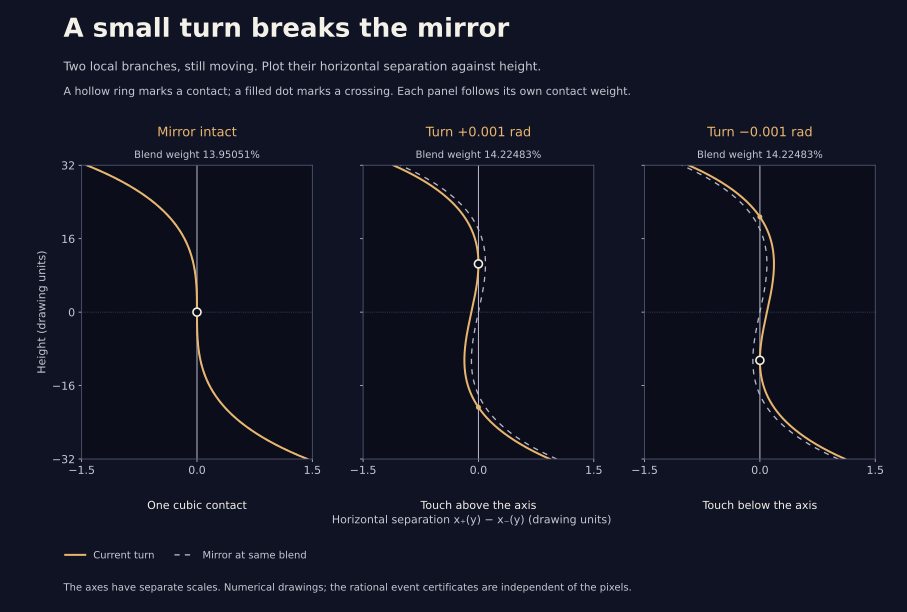

# A small turn breaks the mirror

The first [arm detour](arm_detour.html) has a cubic contact during its
middle leg, at blend weight

```
a₀ ≈ 0.13950512619441832.
```

Its two selected branches share a vertical direction and equal curvature.
Their first different term is cubic. Reflection holds their meeting on the
horizontal axis. What happens if that reflection is broken?

[The interactive study](phase.html) turns both backward arms by the same
small phase φ. A quadratic tangency moves off the axis. The leading
height scales like the signed cube root of φ, and the shift in blend
weight scales like **|φ|^(2/3)**.

This note proves that local limiting law. It also certifies six specified
nonzero-phase tangencies in small rational boxes. Those boxes prove the
existence and uniqueness of one tangency apiece, within their own boxes;
they do not classify all tangencies of all perturbed drawings.

## The family and the two branches

Keep the first arm at 300 and write

```
z(t,a,φ) = 300 exp(it)
         + 140 [(1−a) exp(2it) + a exp(4it)]
         +  65 exp(iφ) [(1−a) exp(−3it) + a exp(−7it)].
```

The phase applies to **both** backward terms, including when one term
has weight zero. Every member is a closed finite Fourier sum.

At φ = 0, the selected end visits are `t = π±u`, with `0 < u < π/2`.
Put `c = cos u`, `s = sin u > 0`. The existing
[axis-return proof](arm_detour.md#the-lens-has-a-continuous-subject)
gives one simple root `G(c,a) = 0`, continuously throughout the leg.
The [contact calculation](arm_detour_events.md) isolates the first
contact by `G = H = 0`. It has

```
G = −300 + 140 [(1−a) U₁ + a U₃] + 65 [(1−a) U₂ + a U₆],
H =  300 − 140 [2(1−a) U₁ + 4a U₃] + 65 [3(1−a) U₂ + 7a U₆],
```

where every U is evaluated at c. At the contact,

```
u ≈ 0.609135743391104,
b = y′(π+u) = −s² G_c ≈ −292.458621858.
```

Because b is nonzero, each visit is an analytic graph of x against
height y. Call the later visit `x₊(y,a,φ)` and the earlier one
`x₋(y,a,φ)`. Let their horizontal separation be

```
g(y,a,φ) = x₊(y,a,φ) − x₋(y,a,φ).
```

A crossing has `g = 0` with `g_y != 0`; a quadratic tangency has
`g = g_y = 0` with `g_yy != 0`. The branch velocities themselves
remain nonzero in either case.

## The phase coefficient is not zero

At the mirror contact, each graph has slope zero. Differentiating x
with respect to φ at **fixed height** therefore gives just the ordinary
partial derivative `x_φ`: the correction `−(x′/y′) y_φ` vanishes.
For the later visit,

```
x_φ(π+u) = −65 [(1−a) sin(3u) + a sin(7u)].
```

At the earlier visit it is the negative of this. Consequently

```
B = g_φ(0,a₀,0)
  = −130 s [(1−a₀) U₂(c) + a₀ U₆(c)].
```

The polynomials `U_k` obey `sin((k+1)u) = s U_k(c)`. Exact interval
evaluation on the existing algebraic contact box proves

```
−91.860 < B < −91.858.
```

This replaces the finite-difference estimate in the earlier
[exploratory probe](phase_contact_probe.py). No transcendental numerical
sign decides the result: the only square root, `s = sqrt(1−c²)`, is
enclosed outward with rational dyadic endpoints by integer square roots.

For completeness, the other two leading coefficients have the exact
formulas

```
J  = G_c H_a − H_c G_a,
A′ = −J / (s G_c²),
K  = −6 c H_c G_c + s² (3 H_c G_cc − H_cc G_c),
C  = K / (6 s⁵ G_c⁴).
```

Here A is the slope of the later branch at height zero on the
unperturbed axis return. The same rational box proves

```
2.384 < A′ < 2.385,
−0.00001933 < C < −0.00001932.
```

More digits, for comparison with the numerical drawing:
`A′ ≈ 2.384068984`, `C ≈ −0.00001932869709`,
`B ≈ −91.858910103`.

## The two-thirds law follows from a rescaling

Write `δ = a−a₀`. The leading terms of the analytic separation are

```
g(y,a₀+δ,φ) = 2 A′ δ y + 2 C y³ + B φ + higher terms.
```

The family satisfies `z(2π−t,a,−φ) = conjugate(z(t,a,φ))`.
This exchanges the selected branches, giving

```
g(−y,a,−φ) = −g(y,a,φ).
```

At zero phase the separation is odd in y. At the contact its linear
term vanishes, while its cubic term does not. These facts exclude all
terms of weighted degree below three when y, δ, φ are assigned weights
1, 2, 3 respectively. The three displayed terms have degree three;
all remaining terms have degree at least five. For example, `δ²y`,
`δy³`, `y⁵`, `δφ`, and `y²φ` are allowed; `yφ` is forbidden by reflection.

Put

```
φ = h³,     y = h v,     δ = h² k.
```

Then `g/h³` and `g_y/h²` extend analytically through h = 0. Their
limiting tangency equations are

```
2 A′ k v + 2 C v³ + B = 0,
2 A′ k   + 6 C v²     = 0.
```

They have the real solution

```
v₀³ = B/(4C) > 0,
k₀  = −3 C v₀²/A′ > 0.
```

The Jacobian of these two equations with respect to (v,k) has determinant
`−24 A′ C v₀²`, which is nonzero. The analytic implicit function theorem
therefore supplies one nearby branch of solutions `v(h), k(h)`.
Reflection makes both functions even in h. Thus

```
y_contact = v₀ cbrt(φ) + O(|φ|),
a_contact − a₀ = k₀ |φ|^(2/3) + O(|φ|^(4/3)).
```

Numerically, `v₀ ≈ 105.9139` and `k₀ ≈ 0.2728418`. For sufficiently
small nonzero φ this is a quadratic tangency: `g_yy = 12 C h v₀ + O(h³)`
is nonzero. Also `g_a = 2 A′ h v₀ + O(h³)` is nonzero and has the
opposite sign to `g_yy`, so increasing a creates two nearby crossings.
The unperturbed cubic contact remains the limiting case at φ = 0.

The theorem is local and does not provide a numerical size for its
neighborhood. The following six boxes supply separate finite-phase
certificates; neither argument is inferred from the other’s pictures.

## Six finite turns, six rational contraction boxes

Use orbit offsets `r₊ = t₊−π`, `r₋ = t₋−π` as independent variables.
For each **exact rational** φ in the table, solve the three equations

```
F(r₊,r₋,a) = (x₊−x₋, y₊−y₋, cross(z′₊,z′₋)) = 0.
```

The first two equations give equal positions. The last gives parallel
directions. A floating-point Newton solve only suggests the center of
a rational box with radius `10⁻¹⁰` in each of its three coordinates.
Every existence and uniqueness decision uses rational bounds.

| Phase φ (radians) | Contact weight, approximately | Height, approximately | Contraction norm below |
| ---: | ---: | ---: | ---: |
| +0.001 | 0.142248319367 | +10.504076656 | 0.00000019 |
| −0.001 | 0.142248319367 | −10.504076656 | 0.00000019 |
| +0.0001 | 0.140093630361 | +4.907289851 | 0.00000071 |
| −0.0001 | 0.140093630361 | −4.907289851 | 0.00000071 |
| +0.00001 | 0.139631799872 | +2.280964329 | 0.0000030 |
| +0.000001 | 0.139532411843 | +1.059050717 | 0.000014 |

The printed numbers are rounded. The executable proof constructs the
actual rational centers and verifies strict inclusions; it does not use
these printed decimals as its boxes.

At each rational angle midpoint q, the sine and cosine Taylor polynomials
through degree 61 have Lagrange error at most `|q|⁶²/62!`. Both functions
are 1-Lipschitz on the real line, so adding half the interval’s width
encloses its complete image. Each coefficient, matrix entry, remainder,
and endpoint is a rational number.

Let R be an exact rational inverse of the midpoint of the interval
Jacobian. For `T(X) = X − R F(X)`, the proof checks

```
||I − R DF(box)||_infinity < 0.1
```

and that `T(center)−center + (I−R DF(box))(box−center)` lies strictly
inside `box−center`. The contraction theorem gives one and only one
zero in the box. Both visits have `y′ < 0` there. Finally the program
proves that the difference in the height-graph curvatures and the
fixed-height weight derivative are nonzero and have opposite signs.
These certify a quadratic tangency with two crossings born as the
weight increases. They exclude a cubic contact at each of the six phases.

## The two graphs cover the whole displayed window

There is also a uniform check behind the choice of branches. On each
orbit-offset interval `[0.46,0.76]` and `[−0.76,−0.46]`, rational
trigonometric bounds prove `y′ < −100` for all

```
0.1375 ≤ a ≤ 0.1456,     −0.001 ≤ φ ≤ 0.001.
```

These ranges contain the complete control rectangle. The low-time
endpoint has height greater than +32 and the high-time endpoint has
height less than −32. A cover of **32 rational time intervals**, with
the full weight and phase ranges retained in each, proves strict
monotonicity. Each height from −32 to +32 therefore has exactly one
visit on each chart, continuously throughout the controls.

This certifies that the two height graphs exist; it does not count their
meetings. The browser rejects a numerical inversion outside these
certified time charts.

## Motion throughout both detours

The earlier [speed cover](arm_detour.md) proves `|z′| > 1` for every
time and weight on all six unperturbed legs. Multiplying both backward
terms by `exp(iφ)` changes velocity by at most

```
65 max(n₀,n₁) |exp(iφ)−1| ≤ 65 × 11 × |φ|.
```

For `|φ| ≤ 0.001` this is at most 0.715, leaving speed **greater than
0.285** throughout all six perturbed legs. This is a complete-family
guarantee, unlike the six local tangency boxes.

The direction’s net turn stays zero by continuity in phase. Factoring
`exp(it)` from position leaves real part at least `R−140−65 ≥ 40`, so
the center’s winding count stays +1. No claim that every region or
crossing survives is needed for either conclusion.

## Reproduce

```sh
python3 experiments/phase_unfolding.py
node experiments/phase_check.js
```

The Python certificate uses only the standard library. It checks 64
exact phase-polynomial identities against independent rational complex
powers, bounds the three local coefficients, certifies the six boxes,
certifies both height charts on the full control rectangle, and reruns
all six continuous speed covers. Matrix, trigonometric,
square-root, and exact halfway-derivative controls check the building
blocks. A nearby box without a root, zero phase, and an out-of-range
phase must be rejected.

The JavaScript drawing uses numerical height inversion and tangency
solves. Its checks compare independent complex powers, finite
differences, reflection, meeting locations, and the six certified
examples. The meeting markers count only the two selected branches
in the displayed height window.



The optional illustration generator, `python3 experiments/plot_phase.py`,
uses Matplotlib. That dependency stays outside the website and every
certificate. The figure is a graph of branch separation, not a stretched
orbital drawing. The interactive study’s full-drawing locator uses
equal axis scales.
