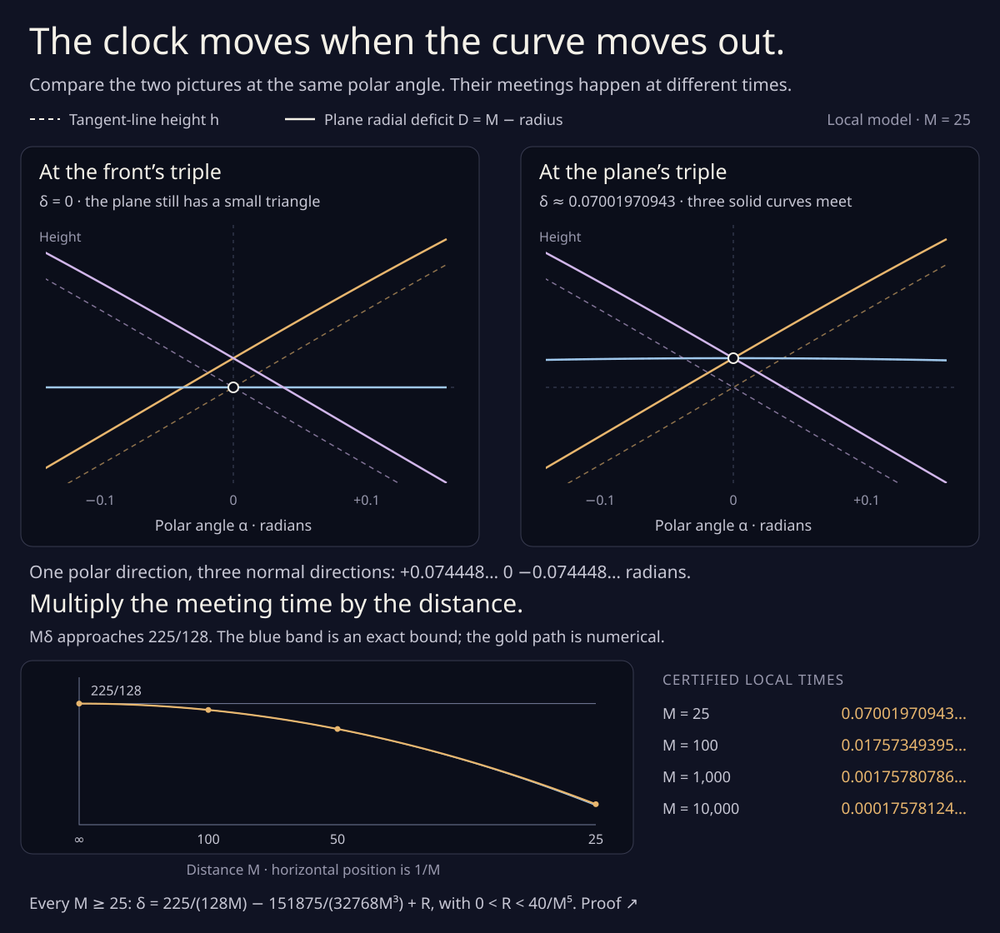
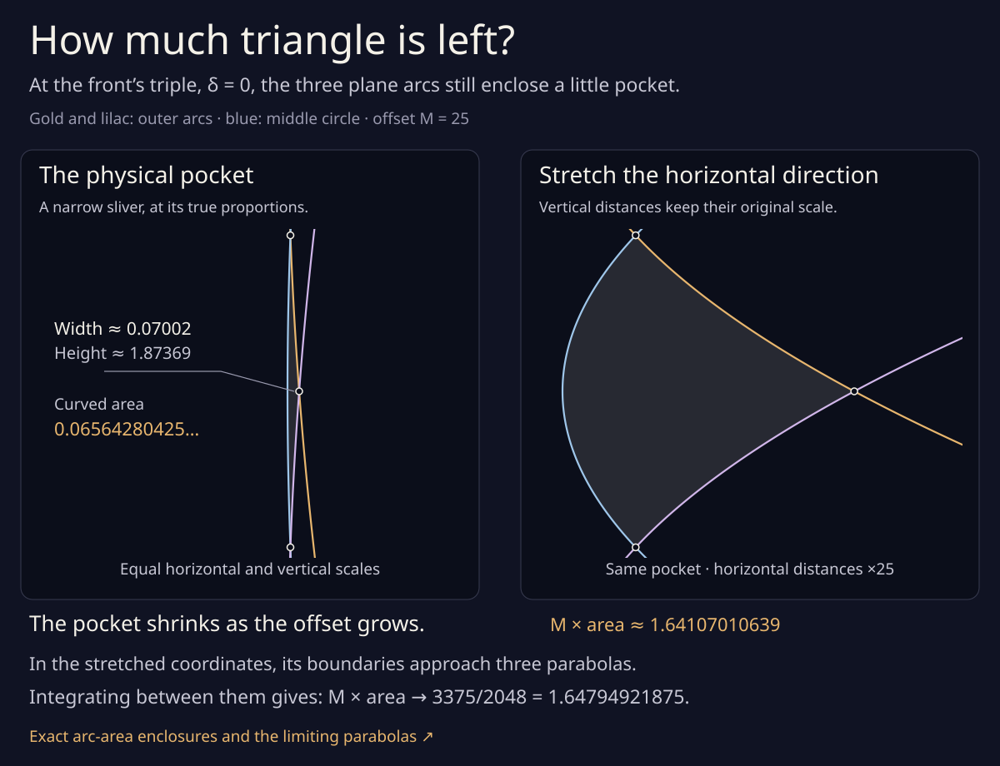

# The clock moves when the curve moves out



The faraway plane drawing approaches its tangent-line graph, but their
triple meetings occur at different moments. The first discrepancy is
particularly simple: **at the same polar angle**, a graph strand with
slope p gains height **p²/(2M)** to first order in the offset distance M.

This gives explicit uniform error bounds, and a local formula for the
time shift of any ordinary three-strand meeting. It does not supply the
remaining numerical event-stability threshold for the
[entire 6,367-move family](radial_word.md).

## Keep the angle fixed

Use the [existing left-normal convention](normal_front.md):

```
N(θ) = (cos θ, sin θ),       p = h_θ,
q_M = (h−M)N + pN′.
```

Let α be the continuous polar angle of −q_M, let r=|q_M|, and put
D_M=M−r. On the same finite angular cover as the front,

```
u = M−h,                r² = u²+p²,
α = θ−atan(p/u),        α_θ = u(u−h_θθ)/r².
```

Suppose the smooth family h(θ,s) has uniform bounds

```
|h| ≤ H,     |h_θ| ≤ P,     |h_θθ| ≤ A,
|h_s| ≤ S,   |h_θs| ≤ B.
```

For **M>H+A**, the coordinate change is strictly increasing. Write
R=M−H>0. Every right-hand h or derivative below is evaluated at
θ(α,s,M), unless an argument α is shown explicitly. Differentiating
while holding α fixed gives three exact identities:

```
λ = r/u = sqrt(1+p²/u²),
(D_M)_α = λp,       (D_M)_s = λh_s,
∂D_M/∂M = 1−λ.
```

For example, at fixed θ,

```
α_s = −(u p_s+p h_s)/r²,
(D_M)_s = (u h_s−p p_s)/r.
```

Adding `(D_M)_θ θ_s` cancels the two mixed-derivative terms and
leaves λh_s. The offset derivative has a similar cancellation.
The symbol ∂/∂M in the last identity varies the offset; the subscript
M in D_M names the function.

## A one-sided bound, including both derivatives

The elementary same-coordinate bounds are

```
|θ−α|                    ≤ P/R,
0 ≤ D_M(α,s)−h(α,s)      ≤ P²/(2R),
|(D_M)_α−h_θ(α,s)|       ≤ AP/R + P³/(2R²),
|(D_M)_s−h_s(α,s)|       ≤ BP/R + SP²/(2R²).
```

Here is why the height bound has a sign. First the raw formula

```
D_M = h(θ,s)−p²/(r+u)
```

and `|θ−α|≤P/R` show that D_M tends uniformly to h(α,s).
But its derivative with respect to M is 1−λ≤0. Integrating from M
to infinity therefore gives the exact positive expression

```
D_M(α,s)−h(α,s) = ∫[M,∞] (λ_L−1) dL.
```

Since `0≤λ_L−1≤P²/[2(L−H)²]`, this proves the stronger one-sided
bound above. The direct triangle-inequality estimate would have given
the looser `3P²/(2R)` without a sign. In contrast, at the **same normal
angle θ** the raw deficit lies below h(θ,s). Changing coordinates is
essential to the sign.

For the derivative bounds, use `λ−1≤P²/(2R²)` and the mean-value
estimates `|p(θ,s)−p(α,s)|≤A|θ−α|` and
`|h_s(θ,s)−h_s(α,s)|≤B|θ−α|` in the exact identities.

## The first correction has a rational error envelope

At fixed α, the leading term is p(α,s)²/(2M). More precisely,

```
|D_M−h−h_θ(α,s)²/(2M)|
    ≤ (H+A)P²/(2R²) + P⁴/(24R³).
```

To see this, compare the integrand λ_L−1 with p(α,s)²/(2L²).
For x≥0,

```
0 ≤ x/2−(sqrt(1+x)−1) ≤ x²/8.
```

Changing the squared slope costs at most `AP²/(L−H)³`; changing
the squared denominator costs at most `HP²/(L−H)³`. The square-root
remainder costs at most `P⁴/[8(L−H)⁴]`. Integrating these three bounds
gives the displayed envelope. All its constants are rational if the
input suprema and offset are rational.

For a smooth family, inversion of
`α=θ−atan(εp/(1−εh))` extends smoothly through ε=1/M=0. Expanding
at fixed α also gives the useful second term

```
D_M = h + p²/(2M) + p²(h+h_θθ)/(2M²) + O(M⁻³).
```

This last expansion is a local Taylor statement for a smooth family;
the explicit envelope above, which needs only the listed bounds, is
the quantitative result used here.

## Every ordinary front triple has a nonzero leading time shift

Suppose three graph strands meet at `(α₀,s₀)`. Let pᵢ be their three
distinct angular slopes there, and bᵢ their route derivatives hᵢ,s.
Ordinariness requires the event Jacobian

```
J = [ p₀−p₁    b₀−b₁ ]
    [ p₀−p₂    b₀−b₂ ]
```

to be nonsingular. The smooth ε extension and the implicit function
theorem give a unique nearby plane triple for sufficiently large M:

```
α_M = α₀ + a₁/M + O(M⁻²),
s_M = s₀ + c₁/M + O(M⁻²).
```

Its two coefficients solve an exact 2×2 system:

```
J (a₁,c₁)ᵀ = −½ (p₀²−p₁², p₀²−p₂²)ᵀ,

c₁ = (p₀−p₁)(p₀−p₂)(p₁−p₂) / (2 det J).
```

Thus **c₁ cannot vanish** at an ordinary three-strand front triple.
The same conclusion follows without the determinant formula: if c₁
were zero, the quadratic `p²/2+a₁p` would take the same value at
three distinct slopes. A nonconstant quadratic cannot do that.

The normal angles of the three plane visits satisfy

```
θᵢ,M = α₀ + (a₁+pᵢ)/M + O(M⁻²).
```

So they are different, even though their polar angles agree. These
are local conclusions with a sufficiently-large-offset condition.
No numerical threshold or complement-of-neighborhood exclusion is
deduced from the 2×2 calculation alone.

The constant 1/2 in the universal height envelope is asymptotically
sharp: at the polynomial example's origin below, p=P=15/8 and
`M(D_M−h)→P²/2`. No smaller constant works for all such families.

## A clock we can enclose

For the [existing polynomial model](positive_front.md#the-plane-triple-comes-at-a-different-moment),

```
h₀=f(x),       h₁=δg(x),       h₂=−f(x),
f=(15x−10x³+3x⁵)/8,           g=(1−x²)³,
−1≤x≤1,       −1/4≤δ≤1/4,
```

the front triple is at `(x,δ)=(0,0)`. Its slopes are
`(15/8,0,−15/8)` and its route rates are `(0,1,0)`. Therefore

```
a₁=0,       c₁=225/128,
δ_M = 225/(128M) + O(M⁻²).
```

The whole three-arc family satisfies
`H=1, P=15/8, A=3, S=1, B=2`. For example,
`|f″|²≤25/3<9`; `|g′|²≤9216/3125<4`; and `−6≤g″≤24/5`.
The endpoint slopes vanish, so the increasing angular map sends
[-1,1] onto itself, and all the same-coordinate comparisons apply.

At M=25 the uniform height discrepancy is at most **0.0732421875**.
At α=0, the two outer deficit graphs actually meet at height
**about 0.07001970943** while their front heights are both zero.
The middle axis visit has deficit δ. It reaches that outer crossing
at positive δ, rather than at the front triple's δ=0.

The separate monotonicity argument already proves exactly one local
plane triple for every M≥25. The fresh rational brackets here repeat
that calculation at 25, 100, 1000, and 10000; they do not infer
existence from sampled geometry.

## A fifth-order remainder for every local offset

In this particular symmetric model, there is a much tighter statement:

```
δ_M = 225/(128M) − 151875/(32768M³) + R_M,
0 < R_M < 40/M⁵                         for every M≥25.
```

In particular `0<δ_M<225/(128M)` throughout that entire half-line.
The exact certificate proves a uniform remainder; the four stored
finite-offset roots serve as independent checks.

Set τ=1/M² and x=√τ U. The positive root equation is

```
F(x,M) = (f(x)−M)sin x + f′(x)cos x = 0.
```

The following two explicit polynomials bracket its scaled root:

```
U_−(τ) = 15/8 − (1125/128)τ + 102τ²,
U_+(τ) = 15/8 − (1125/128)τ + 106τ² − 1500τ³.
```

On the closed interval `0≤τ≤1/625`, both lie in (0,2) and
`U_+−U_−=τ²(4−1500τ)>0` for τ>0. Substitute each into F, write
sin x as `x sinc x`, and use five even Taylor terms for cos and sinc.
The constant and linear τ coefficients cancel exactly. Divide out τ²
before bounding the remaining polynomial by rational Horner intervals.
The omitted terms have absolute bounds `x¹⁰/10!` and `x¹⁰/11!`.
Since `x²=τU²≤4τ`, even the remainder after division is a bounded
multiple of τ³. The resulting exact sign enclosures are contained in

| Test, after dividing by τ² | Rational enclosure, rounded outward |
| --- | --- |
| F at U_− | (0.523, 3.057) |
| F at U_+ | (−1.133, −0.943) |

Also `F_x=(f+f″−M)cos x<0` throughout these positive brackets.
Thus every M≥25 has exactly one bracketed x. This part of the
certificate uses neither archived roots nor a numerical guess.

The parameter function `δ(x)=f(x)−f′(x)tan(x/2)` is strictly
increasing in this window. To bound it at each bracket, multiply by
the positive cos(x/2), use the same Taylor procedure, and again
cancel τ² exactly in

```
[δ(√τ U)/√τ − (225/128 − (151875/32768)τ + Kτ²)] cos(√τ U/2).
```

The lower bracket with K=0 gives a positive normalized residual in
**(35.335, 36.984)**; the upper bracket with K=40 gives a negative one
in **(−1.504, −0.914)**. These four strict sign tests prove the uniform
remainder bound, including arbitrarily large M. τ=0 is used only for
the continuous normalized limits, never as a finite-offset root.

At M=25 the two-term approximation is 0.070015869140625 and its
certified error is less than 0.000004096. At M=100 its error is less
than 0.000000004. This is a quantitative local clock; it still says
nothing about the missing exclusion margins on all the other stages
of the complete eleven-strand movie.

## Narrower blocks need a larger distance

There is a finite threshold for an **isolated rescaled polynomial
three-arc block** as well. Put

```
hᵢ(θ,δ) = C + L (f(x), δg(x), −f(x))ᵢ,
x=θ/w,       0<w≤1,       L>0.
```

For every **M−C≥25L/w²**, these three selected arcs have exactly one
ordinary plane triple in `−1/4≤δ≤1/4`. With K=(M−C)/L its positive
local coordinate and parameter are the unique solution

```
K = f(x) + [f′(x)/w] cot(wx),
δ = f(x) − [f′(x)/w] tan(wx/2),       0<x<1/8.
```

The first right-hand side decreases from infinity to 1, since its
derivative is

```
cot(wx) [f″(x)/w − f′(x)cot(wx)] < 0.
```

At x=1/8 it is at most `f(x)+f′(x)/(w²x)<16/w²`, so the stated
threshold puts the root inside the Taylor window. Also
`tan(wx/2)/w≤tan(x/2)` for 0<w≤1. The already positive unscaled
δ(x) is therefore a lower bound for the rescaled δ; the upper bound
is `f(x)<15/64<1/4`. Its derivative in x remains positive.

Regularity holds throughout: the effective normal-radius coefficient
is at least `K−1−3/w²>0`. The total normal-angle range is 2w<π, so
the selected arcs cannot acquire an inverse tangency. Embeddedness of
their front lifts excludes a direct one. Their distinct boundary
heights exclude a boundary crossing. The limiting pairwise crossing
counts therefore persist down to this threshold, giving the same
unique triple argument as for w=1. The three normals at that event
are wx, 0, −wx, and the ordinary determinant stays nonzero.

The general drift formula becomes

```
δ_M = [225L/(128w²)]/(M−C) + O((M−C)⁻²).
```

This explains the squared-width cost: squeezing a block to half its
angular width requires four times the effective offset for the same
leading delay.

The [canonical construction's block bounds](positive_front.md#a-numerical-bound-for-the-entire-construction)
give L=1, C≤10, and w≥2π/106>3/53. Hence **M≥7813 suffices for each
isolated polynomial three-arc block**. This does not count additional
strands, the alignments into and out of the blocks, the endpoint
straightening, or smoothing. It is expressly **not** a numerical
threshold for the 722-event middle family. The rational scaled-root
checker includes w=3/53, C=10, M=7813, as well as much narrower blocks.

## The triangle left at the front triple



The graph's triple moment is δ=0. At that same moment the middle
plane arc is a radius-M circle, while the two outer arcs still enclose
a curved pocket against it. At M=25 its area is enclosed by

```
0.065642804255745 < area < 0.065642804255746.
```

These are square drawing units. The first picture uses equal coordinate
scales; the narrowness is physical. The second explicitly stretches
horizontal distances by 25, leaving vertical distances alone. Its area
is consequently 25 times the original area. This is the isolated
three-arc model, with no claim that the whole movie has an empty face
in this position.

There are exact arc-area enclosures at four distances:

| M | Area, decimal guide | M × area, decimal guide |
| ---: | ---: | ---: |
| 25 | 0.06564280425575 | 1.641070106394 |
| 100 | 0.01647514990853 | 1.647514990853 |
| 1000 | 0.00164794487360 | 1.647944873600 |
| 10000 | 0.00016479491753 | 1.647949175298 |

Put a=15/8. If x is the outer–outer crossing angle used above, let
u be the outer–circle crossing angle. It is the unique root in
(0,1/8) of the exact polynomial equation

```
f(u)² − 2M f(u) + f′(u)² = 0.
```

Its derivative is `2f′(u)[f(u)+f″(u)−M]<0` in that interval.
Rational bisection therefore isolates the crossing independently of
the trigonometric equation for x. The circle's upper polar opening is

```
v = 2atan(f(u)/f′(u)) − u > 0.
```

For any support graph, Green's area integrand is
`det(q_M,q_M′)=(h−M)(h+h″−M)`. Follow the two outer pocket arcs and
the returning circle arc. Reflection gives the unsigned curved area

```
A_M = M² v − ∫[u,x] (f−M)(f+f″−M) dθ

    = M²[2atan(f(u)/f′(u))−x]
      + M∫[u,x] (2f+f″) dθ − ∫[u,x] f(f+f″) dθ.
```

The last two integrals have rational polynomial primitives. Alternating
arctangent bounds enclose the remaining term. Cancellation between
large pieces is done in rational arithmetic, before rounding the
positive result outward to 96-bit dyadics. Independent sampled boundary
areas at 256 and 1024 segments per arc converge quadratically to those
enclosures; sampling supplies no proof decision.

### Three limiting parabolas

As M grows, `Mx→a` and `Mu→a/2`. Translate the pocket by (+M,0)
and introduce coordinates

```
X = M(qₓ+M),       Y=qᵧ.
```

On the positive outer arc set θ=σ/M. Taylor expansion gives
`X→σ²/2`, `Y→a−σ`. Reflection supplies the other outer arc;
the circle has `X→Y²/2`. Thus the three boundary curves approach

```
X = (a−Y)²/2,       X = Y²/2,       X = (a+Y)²/2.
```

The bounded pocket has `−a/2≤Y≤a/2`. The horizontal gap between
its right and left boundaries is `a²/2−a|Y|`. Its limiting area is

```
∫[−a/2,a/2] (a²/2−a|Y|) dY = a³/4 = 3375/2048.
```

The rescaling multiplies physical area by M, so
**M A_M→3375/2048**, or `A_M∼3375/(2048M)`. The exact finite-distance
area enclosures above check this limit independently. They are not
uniform remainder bounds for the area asymptotic.

### The same area constant at any ordinary front triple

The earlier first correction also gives a universal version. At the
front triple parameter s=s₀, use `ζ=M(α−α₀)` and
`Z=M(D_M−h₀)`. The three rescaled graph strands approach the lines

```
Zᵢ = pᵢ ζ + pᵢ²/2.
```

The triangle they bound has area
`V/8`, where `V=|(p₀−p₁)(p₀−p₂)(p₁−p₂)|`. Radial coordinates
have area Jacobian M−D_M, while the two graph rescalings divide area
by M². Hence the three selected plane branches enclose local area

```
A_M(s₀) = V/(8M) + O(M⁻²).
```

This describes the triangle of those three branches for sufficiently
large M. Calling it a face of a larger drawing additionally requires
excluding other branches.

More generally, at `s=s₀+μ/M`, the limiting lines have extra intercepts
bᵢμ. Their triangle area is

```
(det J)² (μ−c₁)² / (2V).
```

This is the [quadratic triple-area law](triple_area.md) in the new
scale: the triangle vanishes at the shifted clock value μ=c₁. At μ=0,
substituting the time-shift formula reduces it to V/8. Exact controls
compare direct rational line intersections, shoelace areas, and the
older independent determinant formula, including relabelings and the
concurrent limit. The finite-M curved area has this leading expression
divided by M away from μ=c₁. At μ=c₁ the limiting expression vanishes;
this calculation alone says that the area is o(1/M). No numerical
full-movie threshold follows.

## Reproduce

Only the Python and Node standard libraries are needed:

```sh
python3 experiments/radial_limit_check.py
python3 experiments/radial_limit.py
python3 experiments/radial_limit.py --write
node experiments/radial_limit_figure.js
python3 experiments/radial_triangle.py --write
node experiments/radial_triangle_figure.js
```

The [JSON record](radial_limit.json) stores rational derivative bounds,
error envelopes, drift coefficients, the four uniform residual sign
bounds, and four freshly certified local root brackets, rounded outward
to 128-bit dyadics. The uniform height estimates and general triple-shift
theorem are analytic arguments
above; the fifth-order local remainder also has an exact polynomial
certificate. The controls check the algebra and compare independent
numerical geometry. Rounded SVG paths are illustrations. None of these
calculations certifies a new complete event census or the full movie's
numerical threshold.

The [companion area record](radial_triangle.json) is regenerated from
fresh rational roots and exact arc integrals. Its numerical polygon
checks and rounded SVG paths are separate from the area enclosures.
