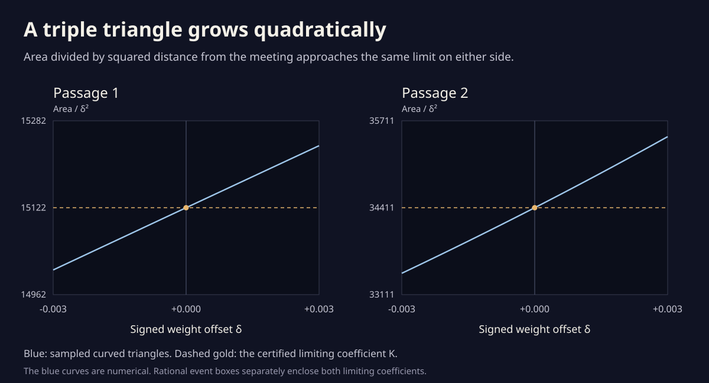

# A triple triangle grows quadratically

The little triangle in [the weave study](weave.html) exists on both
sides of a triple passage. It shrinks to a point, then opens on the
other side. How fast does its unsigned area approach zero?

Write δ for weight minus the exact meeting weight. For either selected
ordinary triple passage,

```
A(δ) = K δ² + O(|δ|³),       K > 0.
```

Rational event boxes certify the coefficients, in drawing-coordinate
square units per squared weight:

| Passage | Certified coefficient K |
| --- | --- |
| First, near weight 0.04712 | 15122.05655 < K < 15122.05659 |
| Second, near weight 0.07551 | 34410.95224 < K < 34410.95230 |

Each reflected partner has exactly the same area by the family's mirror
symmetry. The common leading coefficient on both sides does not imply
equal finite-offset areas. The next correction can distinguish before
from after.



The blue curves are numerical areas of the actual orbital branches.
The horizontal limits have separate rational coefficient enclosures.
Neither plot is a bound on the finite-offset remainder.

## Replace three small arcs by three lines

At the event, let the three visits be t₀, t₁, t₂, with common position p.
For branch i define

```
V_i = ∂z/∂t at (t_i,a₀),
W_i = ∂z/∂a at (t_i,a₀).
```

At weight a₀+δ and time t_i+η, Taylor expansion gives

```
z(t_i+η,a₀+δ) = p + V_i η + W_i δ + O(η²+|ηδ|+δ²).
```

Pairwise transversality gives a smooth crossing for every nearby weight,
by the implicit function theorem. Its time shifts satisfy η = O(δ).
After translating by p and dividing coordinates by δ, the three
branches therefore approach the lines

```
L_i = W_i + span(V_i).
```

An ordinary unfolding makes those three lines form a nondegenerate
triangle. Its area is K. Restoring the scale multiplies both dimensions
by |δ|, explaining the square.

More precisely, each pairwise crossing has expansion
`p_ij(δ) = p + U_ij δ + O(δ²)`, where U_ij is the intersection of
L_i and L_j. The three vertices have separations O(|δ|). Each smooth
boundary arc departs from its chord by O(δ²), so the area between that
arc and chord is O(|δ|³). The straight triangle's determinant formula
then gives `A(δ)=Kδ²+O(|δ|³)` for the curved triangle too.

The [complete-window proof](rhythm_passages.md) excludes additional
visits at the event. For sufficiently small nonzero δ, these three
arcs enclose a face of the full drawing: another part of the connected
curve could not enter its interior without meeting its boundary, which
would supply an additional crossing visit in those selected time slots.
The area law is local; no explicit finite-radius remainder bound is
claimed.

## A formula that needs no line intersections

Write `det(v,w)=v_x w_y−v_y w_x`, and set

```
D_01 = det(V_0,V_1),
D_12 = det(V_1,V_2),
D_20 = det(V_2,V_0),
b_i  = det(V_i,W_i),
H    = b_0 D_12 + b_1 D_20 + b_2 D_01.
```

Then

```
K = H² / (2 |D_01 D_12 D_20|).
```

To verify it, subtract W₀ as a common moving frame and choose coordinates
and tangent scales so that the three lines are

```
y = 0,       y = m₁x+b₁,       y = m₂x+b₂.
```

Pairwise transversality means m₁, m₂, and m₁−m₂ are nonzero. The two
vertices on the horizontal line have separation
`|(m₁b₂−m₂b₁)/(m₁m₂)|`. The other vertex has height
`|(m₁b₂−m₂b₁)/(m₁−m₂)|`. Half base times height is the stated formula.

The expression is independent of the chosen normalization. Rescaling
V_i multiplies its b_i by the same factor; the numerator and denominator
acquire the same product of squared factors. Adding tangential motion
to W_i leaves b_i unchanged. Adding a common motion G to every W_i
leaves H unchanged, by
`D_12 V_0 + D_20 V_1 + D_01 V_2 = 0`. A spatial linear map multiplies
the formula by the absolute value of its determinant, just as it
multiplies area.

This also explains positivity. For transverse branches, H = 0 precisely
when the three linearized lines are concurrent. An ordinary passage
has H ≠ 0. The squared numerator loses the sign of the passage:
**area growth alone does not determine the strangeness jump**.

## The unsquared quantity remembers the sign

Order the three branches by their visits after a basepoint away from
the event. In the strangeness convention used here,

```
St(after) − St(before) = sign(H).
```

Here is a local word calculation. Name the three pairwise crossings
A = 01, B = 12, and C = 02. Their first-visit weights are
`e_A=−sign(D_01)`, `e_B=−sign(D_12)`, and `e_C=−sign(D_02)`.
The first branch meets A and C. Swapping these two first visits leaves
the sum of their weighted mean indices unchanged: their mutual term
is e_A e_C in either order. The net edge-index change across this slot
is also fixed, so the entering index at the second branch stays fixed.

The second branch meets A for the second time, with exponent −e_A,
and B for the first time. Let β_A and β_B be the first-order time shifts
of these visits on that branch. If β_A < β_B, then after the event A
comes before B, whereas before it B comes before A. Thus B's mean index
changes by −e_A. If β_A > β_B, the change is +e_A. All other first-visit
contributions and the base correction stay fixed. Consequently

```
ΔSt = −e_A e_B sign(β_B−β_A).
```

The two intersections of the linearized lines give

```
β_B−β_A = −H/(D_01 D_12).
```

Substitution yields ΔSt = sign(H). Cyclically shifting the three visit
labels preserves H; positive time rescalings multiply it by a positive
factor. The answer therefore does not depend on the basepoint or the
speed chosen along the three branches.

All four refined event boxes certify **H < 0**, independently agreeing
with their −1 jumps from the exact endpoint words. The exact line tests
also check the middle-branch shift identity directly from intersections.

## Certifying the coefficients

```sh
python3 experiments/triple_area.py
python3 experiments/triple_area.py --figure
```

Only the standard library is used. The program first repeats both
complete event-window proofs. It refines each of the four event boxes
to radius **10⁻¹²** in each rational-circle time and weight, using the
same rational contraction test. The refined boxes lie strictly inside
the previously certified event boxes, so they enclose those same events.

In rational-circle coordinates the vectors V_i are derivatives with
respect to s. The formula is unchanged by this positive rescaling of
each tangent. Interval bounds give

```
|ΔV_i| ≤ (89990+1820)·10⁻¹²,
|ΔW_i| ≤ 1820·10⁻¹².
```

All arithmetic in b, D, H, and K is rational interval arithmetic. Every
denominator and H has a certified nonzero sign. Both reflected events
are evaluated separately; each passes the displayed bounds. The symmetry
argument supplies exact equality between the upper and lower areas.

An independent exact check constructs three lines, intersects them,
and computes the resulting triangle's area by a determinant. It passes
**258** rational examples under general linear coordinate maps, positive
and negative tangent rescalings, common translating frames, and arbitrary
tangential branch motion. Degenerate unsplit triples have zero linear
area; parallel-line inputs are rejected.

Finite-offset numerical checks use the actual Fourier branches and
translated shoelace sums with 128 samples per triangle edge. Repeating
with 512 samples changes each area by less than one part per million.
The samples center δ on the drawing's rounded event weights; they are
numerical approximations to the exact-offset ratios.
At |δ| = 10⁻⁵ the observed ratios are:

| Passage | Before: A/(Kδ²) | After: A/(Kδ²) |
| --- | ---: | ---: |
| First | 0.999974858 | 1.000025142 |
| Second | 0.999901236 | 1.000098791 |

The ratios approach one from both sides as the offset decreases through
six scales. This is a numerical approach check. The Taylor argument proves
the exponent and the rational boxes enclose its coefficient.

For comparison, the earlier [loop birth](loop_birth.md) has area exponent
5/2, an ordinary two-branch [tilted touch](phase_unfolding.md) has exponent
3/2, and this transverse three-branch passage has exponent 2. Different
local geometry produces different powers.
